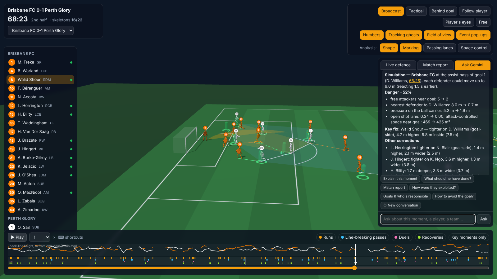
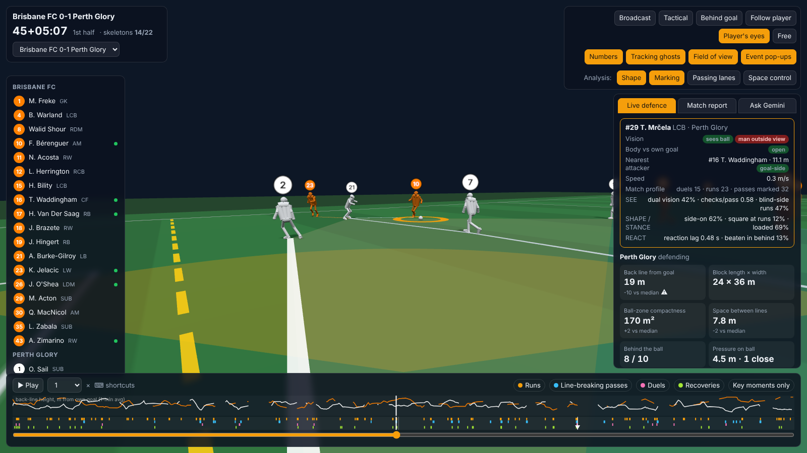

# Defensive Body Language

**A defensive-analysis framework you watch, question and correct in 3D. Every full match is replayed with real SkillCorner skeletons. Gemini answers about the frame on screen, explains why a defence broke and simulates the positions that would have stopped it.**

Analytics Cup 2.0 · Defensive Positioning · SkillCorner A-League 2024/25: the two full body-pose matches (Brisbane v Perth, Sydney v Adelaide).



*Figure 1. Brisbane v Perth, goal 1. After "who is responsible?", the follow-up "how could it be avoided?" takes the viewer to the assist pass. Green figures show positions reachable by reacting 1.5 s earlier: danger −52%.*

## The question

Tracking data shows **where** defenders were. Coaches correct **how** they stood: *"see ball and man"*, *"check your shoulder"*, *"open your body"*, *"get low"*, *"recover goal-side"*. SkillCorner's body pose (29 joints, 25 fps) makes these cues measurable.

Analysts need to **see** the moment, **ask** why, and **show** the fix. The framework is that loop.

## The framework: Watch → Ask → Diagnose → Fix

1. **WATCH (3D).** The whole match plays in the browser at 12.5 fps: ~14 of 22 players as real skeletons, the rest as tracking ghosts. Cameras include **player's eyes**, looking along the defender's head yaw. Overlays show block and offside line, marking and free attackers, passing lanes and space control.
2. **ASK (Gemini, integrated).** Each question carries the frame, selected player, live defensive state and nearby moments. Gemini calls **17 typed, read-only tools** (listed under each answer), **remembers the conversation** (*"and the second goal?"*) and **moves the viewer** to the moments it cites.
3. **DIAGNOSE (computed, never generated).** Two layers:
   - **Team shape** (tracking + Dynamic Events): line height, block size, ball-zone compactness, space between lines, free attackers, pressure, PPDA, line breaks conceded.
   - **Body language**: SEE · SHAPE · STANCE · REACT (below).

   Each goal gets a sequence and per-defender **responsibility indicators**.
4. **FIX (counterfactual).** At any frame or assist pass, each defender moves within what he could reach reacting 1.5 s earlier (≤9 m), attackers fixed, minimising marking danger, shot lane and attack space near goal. Under 10% reduction means positioning was not the problem.

## Body-pose layer: SEE · SHAPE · STANCE · REACT

- **SEE.** Head heading (ear axis + nose) vs ball, receiver and runner; shoulder checks (>75° from the ball in the previous 3 s).
- **SHAPE.** Torso heading (shoulders + hips) vs the carrier (duels) or own goal (runs): open, side-on, square, turned.
- **STANCE.** Hip-height and knee-flexion residual vs the player's **own** norm **at the same speed** (knees go 151°→109° from standing to sprinting).
- **REACT.** Reaction lag to the runner, turning within 1 s, back goal-side within 3 s.

Moments come from **Dynamic Events**: 1,960 engagements, 1,789 opponent passes (marker by Hungarian matching), 1,013 runs, 206 "beaten" situations. Angles are **gated** by SkillCorner's per-joint p90 error (18 cm); above 4 m/s torso heading is within 8.7° (median) of running direction.

## What the two matches say

Stratified risk differences, 95% bootstrap CIs, all in [`docs/RESULTS.md`](docs/RESULTS.md):

- **Open your body.** Defenders **square** when a run starts react 0.97 s after the runner, against 0.45 s when open. They are beaten in behind **42% vs 26%** (+16 pp, CI +1 to +31; n=48).
- **Check your shoulder.** One or more checks in the 3 s before the pass goes with fewer line-breaking passes: 11% vs 17% (−5.9 pp, CI −10 to −2).
- **See ball and man.** With both in view, the receiver is left unpressured 14% vs 32% of the time (−15.7 pp).
- **Get low.** A loaded stance goes with more regains: 19% vs 14% (+4.7 pp).
- **Not supported:** side-on in the duel, blind-side runs, turning within 1 s. Nulls are reported.
- **Goals.** Perth's winner: Burke-Gilroy beaten by Risdon, Shour **saw the ball but not Williams**, Hingert square at the run; simulation **−52%** (preventable). In Sydney v Adelaide, goals 3 and 4 give −4% and −9%: **not** positioning failures.



*Figure 2. "Player's eyes" on Perth's #29 Mrčela: camera at his head, looking where it points. Card: sees the ball, **his man is outside his view**, body open; plus his SEE-SHAPE-STANCE-REACT profile.*

## Why the LLM can be trusted here

Gemini **never computes a number**: it only calls framework tools (`defensive_state`, `goal_breakdown`, `simulate_goal_prevention`, `find_moments`, ...), each shown under the answer. Without a key, a deterministic router answers with the same tools. A Streamlit app (`python -m dbl app`) adds filterable tables, profiles and attack patterns.

## Limitations

- **Two matches.** The findings are associations, meant to prioritise video review. CIs resample moments, not matches.
- **Head ≠ eyes.** The field of view is taken as ±60° of head yaw. Pose exists only for players visible on the broadcast.
- **The simulation holds attackers fixed**: it answers *"was a better shape reachable?"*, not *"would they still score?"*.
- **Thresholds are coaching choices**, all in `dbl/config.py`.

## Reproduce

```bash
git clone https://github.com/kakaz1n/Analyticscup20.git && cd Analyticscup20
python -m venv .venv && source .venv/bin/activate      # Windows: .venv\Scripts\activate
pip install -r requirements.txt
python -m dbl all          # download + pose + moments/shape/evidence + 3D skeletons (~20 min)
python -m dbl viewer       # the framework: 3D viewer + Gemini (localhost:8765)
pytest
```

If Hugging Face is blocked, put the two [SkillCorner/opendata-bodypose](https://huggingface.co/datasets/SkillCorner/opendata-bodypose) zips in `data/pose_raw/`. For Gemini, copy `.env.example` to `.env` and add a key.

## Documentation & references

[`docs/`](docs/README.md) covers install, the illustrated user guide, the framework, results, architecture and data.

References: Bekkers (2025) *Pressing Intensity*; Spearman (2018); Fernández & Bornn (2018); Groom et al. (2026); U.S. Soccer *Visual exploratory behaviour*; Wade *Principles of Defensive Play*.

*Data © SkillCorner, not redistributed. Code: MIT (see `LICENSE.md`).*
