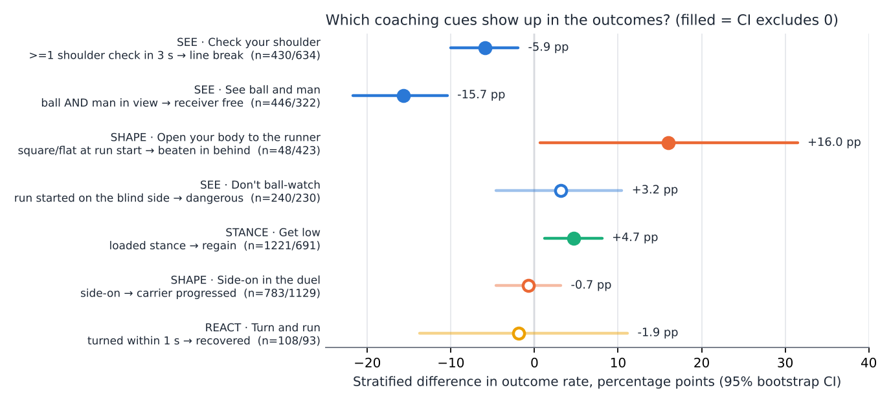
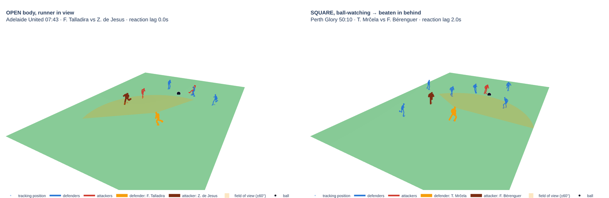

# Defensive Body Language

**SEE · SHAPE · STANCE · REACT: an analyst framework that turns coaching cues for defending into body-pose metrics.**

Analytics Cup 2.0 · Defensive Positioning · SkillCorner A-League 2024/25: the two full body-pose matches (Brisbane v Perth, Sydney v Adelaide).

## The question

Tracking data tells us **where** a defender was. Coaches mostly correct **how** he was standing: *"see ball and man"*, *"check your shoulder"*, *"open your body"*, *"get low"*, *"turn and run"*. SkillCorner's new body pose (29 joints, 25 fps) makes these cues measurable. Can each one be computed at the moment it matters, and does it show up in what happens next?

## The framework

- **SEE**: *see ball and man, check your shoulder, don't ball-watch*. Measured at every opponent pass and off-ball run. Metric: head heading (ear axis + nose) relative to the ball, the receiver and the runner, plus head turns more than 75° away from the ball in the previous 3 s.
- **SHAPE**: *side-on, show him outside, open your body*. Measured at pressing engagements and run starts. Metric: torso heading (shoulders + hips) relative to the line to the carrier and to the own goal, plus the side the chest opens to.
- **STANCE**: *get low*. Measured at pressing engagements. Metric: hip-height and knee-flexion residual against the player's *own* norm *at the same speed*.
- **REACT**: *react to the run, turn and recover*. Measured at runs and after being beaten. Metrics: reaction lag relative to the runner (tracking), whether the player turned within 1 s, and whether he got back goal-side within 3 s.

Moments come from SkillCorner **Dynamic Events**: 1,960 on-ball engagements, 1,789 opponent passes (receiver's marker assigned by Hungarian matching on goal-side distance), 1,013 off-ball runs and 206 "beaten" situations, each with phase of play, third, channel and outcome. Two details make pose usable:

1. **Gating.** Every angle requires its joints under SkillCorner's p90 error gate (18 cm) and anatomically plausible widths. Coverage after gating is 98% of duels, 89% of runs and 59% of passes (passes need both a marker and his pose).
2. **Gait adjustment.** Knee flexion falls from 151° standing to 109° sprinting, so "low" is meaningless in raw form. STANCE is therefore a residual against a speed-binned norm plus a per-player offset.

**Validation:** above 4 m/s, torso heading is within 8.7° (median) of running direction.

## What the two matches say



*Figure 1. Stratified risk differences, 95% bootstrap CIs (1,000 resamples).*

- **Open your body (SHAPE).** Defenders standing **square/flat** when a forward run starts react **0.97 s** after the runner. Open defenders react in 0.45 s. Square defenders are **beaten in behind 42% vs 26%** of the time (+16 pp, CI +1 to +31; only 48 square cases).
- **Check your shoulder (SEE).** When the receiver's marker checked at least once in the 3 s before the pass, line-breaking passes drop from 17% to 11% (−5.9 pp, CI −10 to −2).
- **See ball and man (SEE).** When both are in the marker's view, the receiver is left completely unpressured 14% vs 32% of the time (−15.7 pp, CI −22 to −10).
- **Get low (STANCE).** A loaded stance in pressing engagements goes with more regains: 19% vs 14% (+4.7 pp, CI +1 to +8).
- **Not supported here:** side-on in the duel, blind-side runs (raw gap vanishes within run type), turning within 1 s after being beaten. Reporting nulls is part of the method.



*Figure 2. The 3D viewer (real skeletons, ±60° head cone). Left: open body, runner in view, no lag. Right: square and ball-watching; the runner (brown) starts outside the cone, reaction 2.0 s late, beaten in behind.*

## The tool: an analyst interface with an LLM on top

`python -m dbl app` opens a Streamlit interface with these tabs:

- **Framework / Teams / Players:** evidence table and SEE-SHAPE-STANCE-REACT profiles.
- **Moments:** filter by any metric; click a row for a **3D replay**: real skeletons for ±1.2 s, the defender's field-of-view cone, rotate and play (2D view too).
- **Attack patterns:** which runners start on blind sides, where, and which receivers are fed while their marker can't see both.
- **Match 3D:** the full match with real skeletons, live defensive overlays (shape, free men, lanes, space) and Gemini reading the frame.
- **Ask:** e.g. *"Which Sydney defenders get caught square when runs start? Show the moments."*

The **LLM never computes numbers**: Gemini (`google-genai` function calling) can only call eight typed, read-only tools (`find_moments`, `aggregate`, `player_profiles`, `framework_evidence`, ...); every call is shown under the answer. Without `GEMINI_API_KEY` a deterministic keyword router uses the same tools, so everything runs out of the box.

## Limitations

- **Two matches.** Results are associations to prioritise video review, not causal effects. CIs come from resampling moments, not matches.
- **Head ≠ eyes**: field of view ≈ ±60° of head yaw; pose only for players visible on the broadcast.
- **Thresholds are coaching choices** (side-on 25–70°, check >75° for ≥0.12 s), all in `dbl/config.py`.

## Reproduce

```bash
git clone https://github.com/kakaz1n/Analyticscup20.git && cd Analyticscup20
python -m venv .venv && source .venv/bin/activate      # Windows: .venv\Scripts\activate
pip install -r requirements.txt
python -m dbl all          # download + pose + moments/shape/evidence + 3D skeletons (~20 min)
python -m dbl viewer       # 3D match viewer (localhost:8765)  |  python -m dbl app
pytest
```

If Hugging Face is blocked, put the two zips from [SkillCorner/opendata-bodypose](https://huggingface.co/datasets/SkillCorner/opendata-bodypose) (zipped or unzipped) in `data/pose_raw/`. For the LLM, copy `.env.example` to `.env` with a Gemini key.

## References

Bekkers (2025) *Pressing Intensity*; Spearman (2018); Groom et al. (2026); U.S. Soccer *Visual exploratory behaviour*; Wade *Principles of Defensive Play*. Full documentation: [`docs/`](docs/README.md) — install, user guide, framework, results, architecture.

*Data © SkillCorner, not redistributed. Code: MIT (see `LICENSE.md`).*
