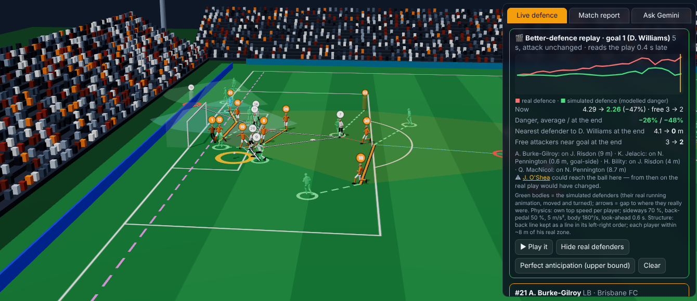
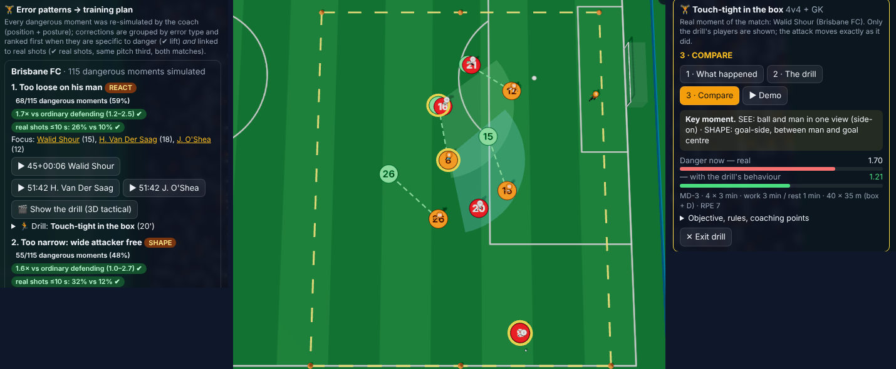

# Defensive Body Language

**Re-simulate how a defence should have moved, find the errors that keep recurring, and turn them into training sessions. All of it runs inside a 3D replay of the match, with real SkillCorner skeletons and Gemini built in.**

Analytics Cup 2.0 · Defensive Positioning · SkillCorner A-League 2024/25: the two matches with full body pose (Brisbane v Perth, Sydney v Adelaide).



*Figure 1. Perth's winner: real attack, Brisbane's simulated defenders in green (reading the play 0.4 s late, own physical limits). Modelled danger at the shot −48%; nearest defender to the scorer 4.1 → 0 m.*

## The question

Coaches correct how defenders **move and stand**: *"squeeze up"*, *"see ball and man"*, *"open your body"*. Tracking shows what happened. We ask what **should** have happened, whether it was reachable, and what to train.

## Watch → Simulate → Find patterns → Train

1. **Watch (3D).** The full match in the browser, ~14 of 22 players as real skeletons, with line, marking, lane and space overlays.
2. **Simulate the defence's movement** (`dbl/replay.py`). For up to 5 s the attack and ball replay unchanged. Every defending outfield player starts where he really was and is steered every 0.2 s to reduce danger:
   - **Physics.** His own top speed from the match; sideways 70% and back-pedal 50%; acceleration ≤ 5 m/s²; body ≤ 180°/s; head ≤ 360°/s within 75° of the body; no sideways sprinting; braking before the lines.
   - **Football structure.** The back four stays a line in its order, and each player stays within ~8 m of his zone.
   - **No clairvoyance.** Decisions use what was visible 0.4 s earlier, extrapolated.
   - **Danger** = threat-weighted unmarked attackers + open shot lane + attack-controlled space near goal. Posture enters it with effects measured in these matches: seeing ball *and* man (×0.82 coverage otherwise), square body (+0.58 s reaction to runs), loaded stance (pressure ×0.75 otherwise).

   A static **coach** solves the same problem at one frame; a **what-if editor** re-scores defenders the analyst drags and rotates.
3. **Find error patterns** (`dbl/patterns.py`). The coach runs on all 582 dangerous moments (line breaks, shot possessions, dangerous runs, duels lost) and 240 ordinary frames. Each correction is tagged with one of 11 error types. A pattern must pass two tests:
   - **specific to danger**: more frequent than in ordinary defending (bootstrap CI);
   - **linked to real shots**: the attack really shot within 10 s more often when it is flagged (same pitch third).
4. **Train** (`dbl/session.py`). Each team's top four patterns become drills with load (MD-day, sets, work:rest, RPE), coaching points, focus players and a KPI for the next match.

   **🎬 Show the drill** replays the real moment in tactical mode with only the drill's players: *what happened*, *the drill* (corrected defence), *compare*. A printable session sheet draws each situation.

Gemini answers about the frame on screen through **typed, read-only tools** (replay, patterns, training plan…): it never computes a number. Without a key, a deterministic router uses the same tools.



*Figure 2. Brisbane's #1 pattern, "too loose on his man" (1.7× more frequent when in danger; real shot within 10 s 26% vs 10%), played as a 4v4 drill on the real moment: real defence orange, drill defence green.*

## What it finds

- **Errors linked to real shots** (both matches, Δ within pitch third, 95% CI):
  - no pressure on the ball carrier, +14 pp (+2 to +25);
  - ball-watching, man not in view, +13 pp (+4 to +22), the body-pose error;
  - too narrow, +12 pp;
  - back line too deep, +8 pp;
  - too loose on his man, +7 pp.
- **Not linked (ranked lower):** lost goal-side, line too high, too wide, not covering space.
- **Plans.**
  - Perth: too loose, line too deep, ball-watching.
  - Adelaide: line too deep, ball-watching.
  - Brisbane: too loose, too narrow.
  - Sydney: too loose, too narrow, line too deep.
- **Goals.** Read-late replays cut modelled danger at the shot by 34–61% on five of six goals. Adelaide's goal is the least preventable (−9%).
- **Body pose.** Square at a run start: reaction 0.97 s vs 0.45 s open, beaten in behind 42% vs 26%.

## Is the simulation trustworthy? (`python -m dbl validate`)

- **The marking term matches real passing.**
  - Passes to attackers the model rates *free* are completed 98% of the time; to *tightly marked* ones, 73%.
  - The option actually chosen is the freer one (AUC 0.57, CI 0.55–0.60).
  - Agreement with SkillCorner's independent xPass: ρ 0.61.
- **Simulated players move like players.**
  - Same 5 s: 18 m run vs 17 m real; top speed 7.5 vs 8.2 m/s; acceleration ≤ 5.3 m/s² (pace changes more frequent than real).
- **Not supported.** The total danger does not predict shots better than the ball's location (out-of-match AUC 0.75 vs 0.80), so a "−48%" is a reduction of a principled objective, not of shot probability.
- **Sensitivity.** The one free control weight moves a goal's percentage by up to ~35 points: the direction is stable, the exact figure is not.

## Limitations

- **Two matches.** Patterns are associations to prioritise training, not proven causes; each drill's KPI is how to check it.
- **The attack does not react** to the simulated defence. A defender reaching the ball is flagged rather than played on.
- **Head ≠ eyes.** Pose exists only for players visible on the broadcast.

## Reproduce

```bash
git clone https://github.com/kakaz1n/Analyticscup20.git && cd Analyticscup20
python -m venv .venv && source .venv/bin/activate      # Windows: .venv\Scripts\activate
pip install -r requirements.txt
python -m dbl all          # download → pose → simulations → patterns → validation (~45 min)
python -m dbl viewer       # 3D viewer + simulation + training (localhost:8765)
pytest
```

If huggingface.co is blocked, put the two [SkillCorner/opendata-bodypose](https://huggingface.co/datasets/SkillCorner/opendata-bodypose) zips in `data/pose_raw/`. For Gemini, copy `.env.example` to `.env` and add a key (optional).

Details: [`docs/`](docs/README.md).

References: Spearman (2018); Fernández & Bornn (2018); Shah (2026, Analytics Cup).

*Data © SkillCorner, not redistributed. Code: MIT (`LICENSE.md`).*
