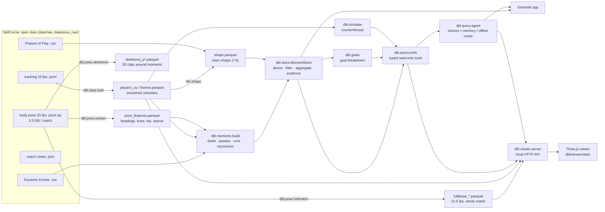

# Architecture

## Overview



## Package layout

```
dbl/
  config.py            paths, match ids, every threshold (Thresholds dataclass)
  geometry.py          angle helpers
  data/download.py     SkillCorner + Hugging Face download, SHA-256 check
  data/load.py         match sheet, events, phases, tracking parse + Savitzky-Golay velocities
  pose/extract.py      stream pose JSON -> per player-frame features (gated by joint error)
  pose/skeletons.py    3D clips around each moment (int16 cm, per period)
  pose/fullmatch.py    full-match skeletons 12.5 fps (10-min blocks); chunked mode for small machines
  moments/context.py   MatchContext: defender-normalised frame, pose windows, posture norms, Hungarian marking
  moments/build.py     the four moment families + body-pose features + outcomes
  framework.py         SEE-SHAPE-STANCE-REACT metric/outcome catalogue + pre-registered comparisons
  store.py             MomentStore: derived columns, filter/aggregate, profiles, stratified evidence + bootstrap
  shape.py             team shape time series, shape by phase, event KPIs (PPDA, counter-press…), insights
  goals.py             goal detection (validated vs match sheet), sequence, responsibility indicators
  simulate.py          counterfactual positional optimisation (reachable discs, danger objective)
  coach.py             posture-aware coach (position + body + head + stance, calibrated on the evidence) and what-if scoring
  replay.py            better-defence replay: re-simulates all defenders' movement for ≤ 5 s against the real attack
  patterns.py          error patterns mined from coaching every dangerous moment; drill catalogue; training plans
  session.py           printable session sheet: load per drill + pitch diagram of the real match situation
  gait.py              per-player running clips by speed band (animation of simulated defenders)
  report.py            docs/RESULTS.md generator
  query/tools.py       typed tools exposed to the LLM (strict-JSON outputs)
  query/agent.py       Gemini function calling, forced final answer, conversation memory, offline router
  viewer/server.py     local HTTP server + API for the 3D viewer
  viewer/static/       index.html, viewer.js (engine), analysis.js (live metrics, pitch control),
                       overlays.js (three.js overlays + simulation), coach.js (coach/editor/replay),
                       drill.js (3D tactical drill mode), panel.js (UI), vendor/three.js r160 (MIT)
  viz/                 2D pitch (plotly/matplotlib), 3D moment scene (plotly), README figures
  cli.py               `python -m dbl …`
app/streamlit_app.py   Streamlit interface
tests/                 unit (geometry, pose maths) + integration (pipeline, shape, goals, simulation, API)
```

## Coordinate conventions

- SkillCorner metres, origin at the centre spot, x along the length, y across, z up.
- **Defender-normalised frame** (all moment tables, shape, simulation): coordinates rotated 180° when needed so the
  *defending* team always defends the goal at `x = -L/2`; "goal-ward" is −x. Headings rotate with it.
- Headings: degrees in (−180, 180], 0 = +x, counter-clockwise. "Forward" of a left/right joint pair = the
  left→right axis rotated +90° (as in SkillCorner's `pose_orientation.py`).
- Clocks: tracking frame (10 fps) is the master clock; pose frame = 2.5 × tracking frame.
- The 3D viewer shows raw (broadcast) orientation, not normalised.

## Build artefacts

`data/build/<match_id>/`

| File | Rows (≈) | Content |
|---|---|---|
| `frames.parquet` | 60k | per tracking frame: period, ball x/y/z, possession group/player |
| `players_xy.parquet` | 1M | per player-frame: x, y, detected, vx, vy, speed |
| `pose_features.parquet` | 1.5M | per player pose frame (25 fps): torso/shoulder/hip/head heading, knee, hip height, stance, stagger, errors |
| `duels / passes / runs / recoveries.parquet` | 1k / 0.9k / 0.5k / 0.1k | the moment tables (below) |
| `shape.parquet` | 7k | team shape of the team out of possession at 2 Hz |
| `skeletons_p1/p2.parquet` | 250k | 23 joints (int16 cm) around each moment |
| `full/pose_<period>_<block>.parquet` | 1.1M | full-match skeletons 12.5 fps |
| `players.parquet` | 36 | squad with roles |
| `sim_moments.parquet` | 400 | every dangerous moment (+ control frames) coached: danger before / after, kind, phase, third, channel |
| `sim_corrections.parquet` | 2k | per defender correction: error tag, avoidable danger, move |

`data/build/evidence.json` — the pre-registered comparisons (written by `python -m dbl build`).

### Moment tables

#### `duels` (1,960 rows)

| Column | Meaning |
|---|---|
| `match_id` | SkillCorner match id |
| `period` | 1 or 2 |
| `frame` | tracking frame (10 fps) of the moment |
| `minute` | match minute (SkillCorner) |
| `second` | second within the minute |
| `phase_oop` | phase of the defending team (high_block, medium_block, low_block, defending_transition, …) |
| `phase_ip` | phase of the attacking team |
| `third` | third of the pitch (attacking perspective) |
| `channel` | channel (wide/half-space/centre) |
| `game_state` | winning/drawing/losing |
| `event_id` | SkillCorner Dynamic Events id (unique within a match) |
| `moment` | duel / pass / run / recovery |
| `subtype` | SkillCorner subtype (e.g. pressure, counter_press, run_ahead_of_the_ball) |
| `defending_team` | team out of possession |
| `attacking_team` | team in possession |
| `defender_id` | defender (player id) |
| `defender` | defender name |
| `defender_role` | defender role acronym |
| `attacker_id` | attacker (player id) |
| `attacker` | attacker name |
| `x` | defender x (m, defender-normalised: own goal at x=-L/2) |
| `y` | defender y (m) |
| `carrier_x` | carrier x |
| `carrier_y` | carrier y |
| `distance_m` | defender–carrier distance at engagement |
| `def_speed` | defender speed (m/s) |
| `approach_decel` | peak speed in last 1 s minus speed at engagement |
| `closing_speed` | rate the gap to the carrier closed (m/s) |
| `goal_side` | defender between attacker and goal |
| `pose_frames` | number of 25 fps pose frames used |
| `body_angle` | |torso − line to carrier| (deg) |
| `body_shape` | duels: square / side_on / turned; runs: open / square / turned |
| `shows` | side the chest opens to: outside / inside / none |
| `knee_deg` | median knee angle (deg) |
| `hip_drop_m` | speed-adjusted hip-height residual (m, + = lower than usual) |
| `knee_extra_deg` | speed-adjusted extra knee flexion (deg) |
| `stagger_m` | foot split along the torso direction (m) |
| `loaded_stance` | 1 if hip ≥3 cm lower or knees ≥5° more flexed than his norm at that speed |
| `eyes_on_ball` | head within ±60° of the carrier |
| `beaten` | SkillCorner: beaten by possession or movement |
| `beaten_by_possession` | SkillCorner flag |
| `beaten_by_movement` | SkillCorner flag |
| `regain` | engagement ended in a regain |
| `disruption` | ended in a disruption |
| `foul` | foul committed |
| `danger_stopped` | stopped/reduced possession danger |
| `forced_backward` | carrier forced backward |
| `pressing_chain_end` | SkillCorner pressing chain end |
| `frame_end` | last frame of the event |
| `carrier_outcome` | what the pressed carrier did: lost_ball / shot / line_break_pass / forward_pass / safe_pass |
| `carrier_progressed` | shot, line break or forward pass |
| `carrier_pressure` | pressure at the end of the carrier's possession |
| `side_on` | 1 if body_shape == side_on |
| `distance_band` | <3 m / 3-6 m / >6 m |
| `time` | mm:ss label |

#### `passes` (1,789 rows)

| Column | Meaning |
|---|---|
| `match_id` | SkillCorner match id |
| `period` | 1 or 2 |
| `frame` | tracking frame (10 fps) of the moment |
| `minute` | match minute (SkillCorner) |
| `second` | second within the minute |
| `phase_oop` | phase of the defending team (high_block, medium_block, low_block, defending_transition, …) |
| `phase_ip` | phase of the attacking team |
| `third` | third of the pitch (attacking perspective) |
| `channel` | channel (wide/half-space/centre) |
| `game_state` | winning/drawing/losing |
| `event_id` | SkillCorner Dynamic Events id (unique within a match) |
| `moment` | duel / pass / run / recovery |
| `defending_team` | team out of possession |
| `attacking_team` | team in possession |
| `passer` | passer name |
| `attacker_id` | attacker (player id) |
| `attacker` | attacker name |
| `receiver_x` | receiver x |
| `receiver_y` | receiver y |
| `pass_success` | pass completed |
| `line_break` | pass broke ≥1 defensive line |
| `last_line_break` | pass broke the last line |
| `lead_to_shot` | possession led to a shot |
| `pass_xthreat` | SkillCorner xThreat of the target |
| `dangerous` | SkillCorner dangerous flag |
| `receiver_pressure` | pressure label at reception |
| `receiver_pressure_id` | 1 (none) … 5 (very high) |
| `receiver_epv_gain` | EPV change of the receiver's possession |
| `marker_id` | receiver's marker (Hungarian assignment) |
| `team_ball_awareness` | share of defenders (with pose) with ball in view |
| `team_pose_n` | defenders with pose at the pass |
| `defender_id` | defender (player id) |
| `defender` | defender name |
| `defender_role` | defender role acronym |
| `x` | defender x (m, defender-normalised: own goal at x=-L/2) |
| `y` | defender y (m) |
| `marking_distance` | marker–receiver distance (m) |
| `goal_side` | defender between attacker and goal |
| `pose_frames` | number of 25 fps pose frames used |
| `head_to_ball_deg` | |head − direction to ball| |
| `head_to_man_deg` | |head − direction to receiver| |
| `ball_man_split_deg` | angle between ball and receiver seen from the marker |
| `ball_in_view` | ball within ±60° |
| `man_in_view` | receiver within ±60° |
| `vision` | ball_and_man / ball_only / man_only / neither |
| `shoulder_checks` | head turns >75° from the ball for ≥0.12 s in the previous 3 s |
| `ball_watch_share` | share of the 3 s window looking at the ball |
| `receiver_free` | 1 if no pressure at reception |
| `receiver_low_pressure` | 1 if pressure ≤ low |
| `checked` | 1 if ≥1 shoulder check |
| `dual_vision` | 1 if vision == ball_and_man |
| `marking_band` | <3 / 3-6 / 6-9 / >9 m |
| `time` | mm:ss label |

#### `runs` (1,013 rows)

| Column | Meaning |
|---|---|
| `match_id` | SkillCorner match id |
| `period` | 1 or 2 |
| `frame` | tracking frame (10 fps) of the moment |
| `minute` | match minute (SkillCorner) |
| `second` | second within the minute |
| `phase_oop` | phase of the defending team (high_block, medium_block, low_block, defending_transition, …) |
| `phase_ip` | phase of the attacking team |
| `third` | third of the pitch (attacking perspective) |
| `channel` | channel (wide/half-space/centre) |
| `game_state` | winning/drawing/losing |
| `event_id` | SkillCorner Dynamic Events id (unique within a match) |
| `moment` | duel / pass / run / recovery |
| `subtype` | SkillCorner subtype (e.g. pressure, counter_press, run_ahead_of_the_ball) |
| `defending_team` | team out of possession |
| `attacking_team` | team in possession |
| `attacker_id` | attacker (player id) |
| `attacker` | attacker name |
| `defender_id` | defender (player id) |
| `defender` | defender name |
| `defender_role` | defender role acronym |
| `x` | defender x (m, defender-normalised: own goal at x=-L/2) |
| `y` | defender y (m) |
| `runner_x` | runner x |
| `runner_y` | runner y |
| `runner_distance` | defender–runner distance at run start |
| `runner_goal_side_of_defender` | runner already goal-side at start |
| `targeted` | run targeted by a pass |
| `received` | runner received |
| `dangerous` | SkillCorner dangerous flag |
| `lead_to_shot` | possession led to a shot |
| `separation_gain` | SkillCorner separation gain |
| `break_line` | run broke the defensive line |
| `pose_frames` | number of 25 fps pose frames used |
| `head_to_runner_deg` | |head − direction to runner| |
| `head_to_ball_deg` | |head − direction to ball| |
| `runner_in_view` | runner within ±60° |
| `blind_side` | runner outside view while the ball was in view |
| `torso_to_goal_deg` | torso vs own-goal direction (0 = facing own goal) |
| `body_shape` | duels: square / side_on / turned; runs: open / square / turned |
| `beaten_in_behind` | runner started level/behind and finished goal-side of the defender |
| `frame_end` | last frame of the event |
| `reaction_lag_s` | seconds the defender reached 2.5 m/s goal-ward after the runner |
| `reacted` | defender reached the threshold within 2 s |
| `forward_run` | run type is forward (ahead of the ball, behind, overlap, …) |
| `square_body` | 1 if body_shape == square |
| `time` | mm:ss label |

#### `recoveries` (206 rows)

| Column | Meaning |
|---|---|
| `match_id` | SkillCorner match id |
| `period` | 1 or 2 |
| `minute` | match minute (SkillCorner) |
| `second` | second within the minute |
| `event_id` | SkillCorner Dynamic Events id (unique within a match) |
| `defending_team` | team out of possession |
| `attacking_team` | team in possession |
| `defender_id` | defender (player id) |
| `defender` | defender name |
| `defender_role` | defender role acronym |
| `attacker_id` | attacker (player id) |
| `attacker` | attacker name |
| `phase_oop` | phase of the defending team (high_block, medium_block, low_block, defending_transition, …) |
| `third` | third of the pitch (attacking perspective) |
| `channel` | channel (wide/half-space/centre) |
| `subtype` | SkillCorner subtype (e.g. pressure, counter_press, run_ahead_of_the_ball) |
| `moment` | duel / pass / run / recovery |
| `source` | duel (dribbled) or run (got in behind) |
| `frame` | tracking frame (10 fps) of the moment |
| `x` | defender x (m, defender-normalised: own goal at x=-L/2) |
| `y` | defender y (m) |
| `recovered` | back goal-side within 3 s |
| `time_to_goal_side_s` | seconds to get back goal-side |
| `max_recovery_speed` | peak speed in the 3 s |
| `turned_within_1s` | torso within 60° of own goal within 1 s |
| `pose_frames` | number of 25 fps pose frames used |
| `time` | mm:ss label |


## Local HTTP API (`dbl/viewer/server.py`, 127.0.0.1 only)

| Method & path | Params | Returns |
|---|---|---|
| GET `/api/matches` | – | matches with full-match skeletons |
| GET `/api/meta` | match | teams & kit colours, players, periods, joints/bones, timeline events, clock map, home side |
| GET `/api/pose` | match, from, to (tracking frames) | binary: `int32 n, int32 nJ, int32 frame25[n], int32 pid[n], int16 joints[n·nJ·3]` (cm, −32768 = missing) |
| GET `/api/track` | match, from, to | tracking positions per player + ball (JSON) |
| GET `/api/insights` | match | match report (bullets, shape by phase, KPIs, body profile) |
| GET `/api/series` | match | back-line height / ball-zone area per team (1-min smoothed) |
| GET `/api/goals` | match | goal breakdowns |
| GET `/api/simulate` | match & (goal \| frame [, team, focus]) [, player, posture=0\|1] | counterfactual coach result (cached); `player` = coach one defender, `posture=0` = position-only model |
| GET `/api/gait` | match | per-player running clips (int16 cm, in place, facing +x) by speed band |
| GET `/api/drill` | match, frame, team, player, tag | drill data for the 3D tactical drill mode (`drill.js`): 5 s of real attack + real and corrected defenders of the drill format, area, drill, load, danger |
| GET `/training/sheet` | match, team | printable HTML session sheet |
| GET `/api/training` | match | training plan of both teams (patterns, evidence, players, examples, drills) |
| GET `/api/replay` | match & (goal \| frame [, team, focus]) [, seconds ≤ 5, mode=clairvoyant] | per-0.2 s simulated defenders (x, y, torso, head, stance), danger real vs simulated, differences, ball-reachable events (cached) |
| POST `/api/whatif` | `{match, frame, focus, team, edits:[{player_id, x, y, torso, head, loaded}]}` (raw coords / degrees) | danger vs what happened + per-defender read-out (sees ball / man, shape, reaction, stance); positions clamped to the reach disc |
| GET `/api/players` | match | per-player framework profile |
| POST `/api/ask` | `{question, match, frame, clock, selected, live, history, session}` | `{text, backend, calls, data, focus}` |
| POST `/api/reset` | `{session}` | forget a conversation |

All JSON is strict (NaN → null).

## LLM tools (`dbl/query/tools.py`)

Gemini can only call these read-only functions; each returns strict JSON computed by pandas.

| Tool | What it returns |
|---|---|
| `describe_framework` | Return the SEE-SHAPE-STANCE-REACT framework: principles, every metric (definition, coaching cue, table it lives in) and every outcome. Call this first when unsure which column answers a question. |
| `list_columns` | List the columns of a moment table ('duels', 'passes', 'runs' or 'recoveries') with example values. |
| `find_moments` | Filter individual defensive moments. Args: table: 'duels' (pressing engagements), 'passes' (opponent passes, receiver's marker), 'runs' (opponent off-ball runs, nearest/assigned defender) or 'recoveries' (after being beaten). where_json: JSON object of exact f… |
| `aggregate` | Average metrics/outcomes (booleans become rates) over moments, optionally grouped. Example: aggregate('runs', ['beaten_in_behind', 'dangerous'], ['defending_team', 'body_shape'], where_json='{"forward_run": true}'). Always report the 'n' column with any rate. |
| `player_profiles` | One row per defender with SEE/SHAPE/STANCE/REACT summary metrics (rates in 0-1, counts as n). Filter by team name and sort by any column (e.g. 'blind_side', 'dual_vision', 'regain'). |
| `team_profiles` | One row per team (as defending side): side-on rate, loaded stance, regains, dual vision, shoulder checks, receivers left free, blind-side runs conceded, square body at runs, beaten in behind, reaction lag. |
| `framework_evidence` | The pre-registered comparisons linking each body-pose cue to an outcome, with stratified risk differences and 95% bootstrap CIs. finding_id optional (e.g. 'open_body_runs'). |
| `open_moment` | Full detail for one moment (all computed pose/tracking features and outcomes). |
| `list_matches` | The matches available, with ids, titles and the two teams of each. |
| `match_insights` | Deterministic defensive report for one match, per team: block type mix (high/medium/low), back-line height, block length/width/area, ball-zone compactness (5 defenders nearest the ball), space between lines, free attackers near goal, PPDA, counter-pressing, re… |
| `shape_by_phase` | Median defensive-shape metrics of each team per out-of-possession phase (high_block, medium_block, low_block, defending_transition, defending_quick_break, defending_direct, defending_set_play, chaotic), with share of time. Distances in metres from own goal; ar… |
| `defensive_state` | Snapshot of the team out of possession at a tracking frame (10 fps; minute*600 approx. + period offset): phase, back-line height, block length/width/area, ball-zone compactness, line gap, players behind ball, nearest defender to ball, defenders within 5 m of b… |
| `moments_window` | All framework moments (duels, passes, runs, recoveries) between two tracking frames of a match, with their body-pose features and outcomes. Use to explain what happened in a passage of play. |
| `goals` | All goals of a match in order: goal_number, scoring team, conceding team, time, tracking frame, scorer, assister, score after the goal. Use this FIRST for any question about a goal ('first goal', 'the 3rd goal'). |
| `goal_breakdown` | How a goal happened and which defenders carry responsibility. Returns the attacking sequence (passes, line breaks, pressure on the ball), the conceding team's shape at the assist and at the shot, the situation at the shot (nearest defender to the scorer, dista… |
| `simulate_goal_prevention` | Counterfactual coaching at a goal's assist: safest reachable position and posture (torso, head, stance) per conceding defender; before/after metrics, `reduction_parts` {posture_only, position_only, both}, ranked corrections with `gain_position` / `gain_posture` and the coaching sentence. |
| `simulate_defence` | Same position + posture counterfactual at any tracking frame (the team out of possession is optimised). |
| `replay_better_defence` | Re-simulate the movement of all defenders for ≤ 5 s (attack unchanged): danger curve, mean / end reduction, who defends differently, ball-reachable events; realistic (reads the play 0.4 s late) or perfect anticipation. |
| `error_patterns` | Recurring error types of a team from all its simulated dangerous moments: rate, lift vs ordinary defending (bootstrap CI), avoidable danger, players, where, examples. |
| `training_plan` | Session for a team from its top error patterns: evidence, players, examples, drills with coaching points and KPIs. |
| `coach_defender` | Teach one defender at a frame: what he should have done (position within reach, body, where to look, stance) with everybody else as they were. |

### Agent behaviour (`dbl/query/agent.py`)

- `google-genai` automatic function calling (≤ 8 calls). If the model stops on a tool call without text, a second
  call **without tools** forces a written answer from the data already retrieved.
- **Memory**: per conversation (`session` id) the full Gemini history — questions, tool calls, tool results,
  answers — is kept in memory on the local server (trimmed to the last 40 items, never splitting a call from its
  result). The offline router keeps a *topic* (match, goal) so follow-ups like "and the second?" resolve.
- Viewer questions carry a `[CONTEXT]` block: match, frame, clock, selected player, live overlay state,
  `defensive_state`, nearby moments and goals — most answers need ≤ 2 tool calls.
- `focus` in the answer tells the viewer where to go (goal build-up, moment, or a simulation to draw).

## Extending

- **New metric**: compute it in `moments/build.py` (it has the pose window and tracking), add it to
  `framework.METRICS`, optionally a comparison in `framework.FINDINGS`; it appears in the app, in the tools and in
  `framework_evidence` automatically.
- **New threshold**: `config.Thresholds`.
- **Frame-exact capture** (videos, tours): `window.__manual = true` stops the render loop; `window.__step(1/30)` advances exactly one frame (virtual clock for animations).
- **New overlay**: compute in `viewer/static/analysis.js::analyse`, draw in `overlays.js::update`, toggle in `index.html`.
- **New tool for Gemini**: add a typed function with a docstring to `query/tools.py` and to `TOOLS`.
- **More matches**: add ids to `config.MATCHES` (any SkillCorner match with body pose).

## Third-party code

`dbl/viewer/static/vendor/three.module.min.js` and `OrbitControls.js` — three.js r160, MIT (see `THREE_LICENSE`).
Pose-gating approach adapted from SkillCorner's open-data tutorial `src/features/pose_orientation.py` (MIT).
