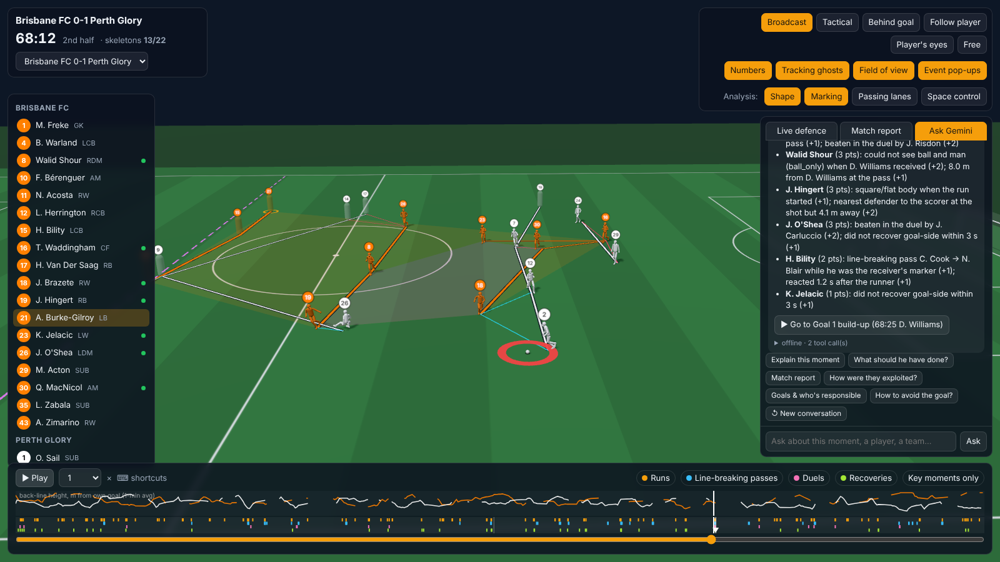
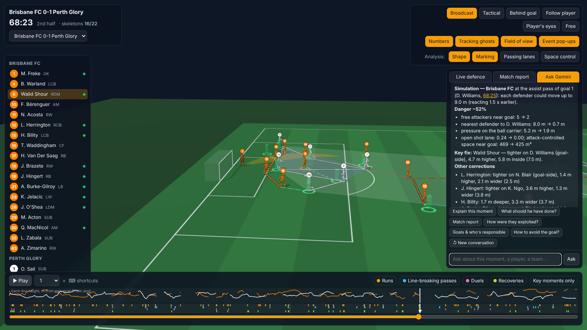
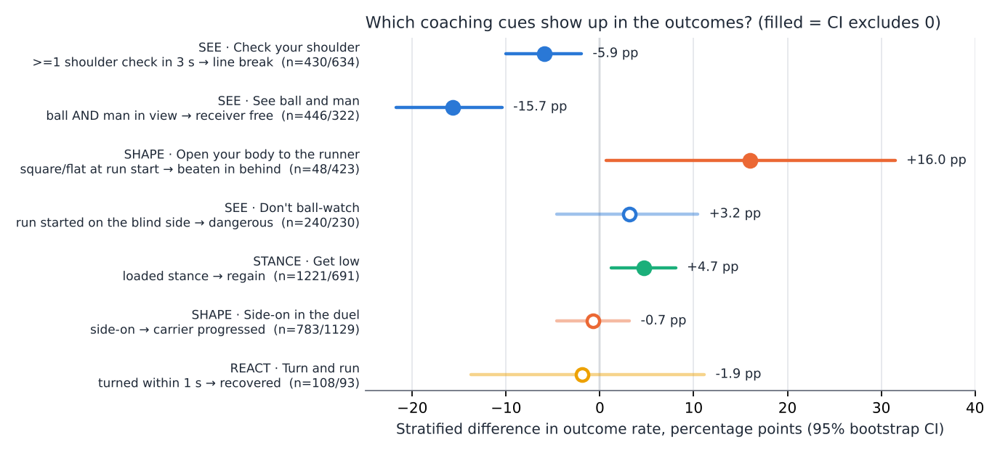
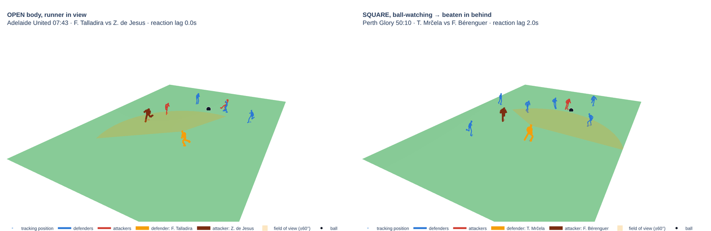
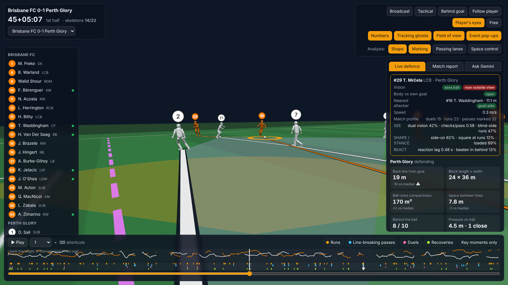
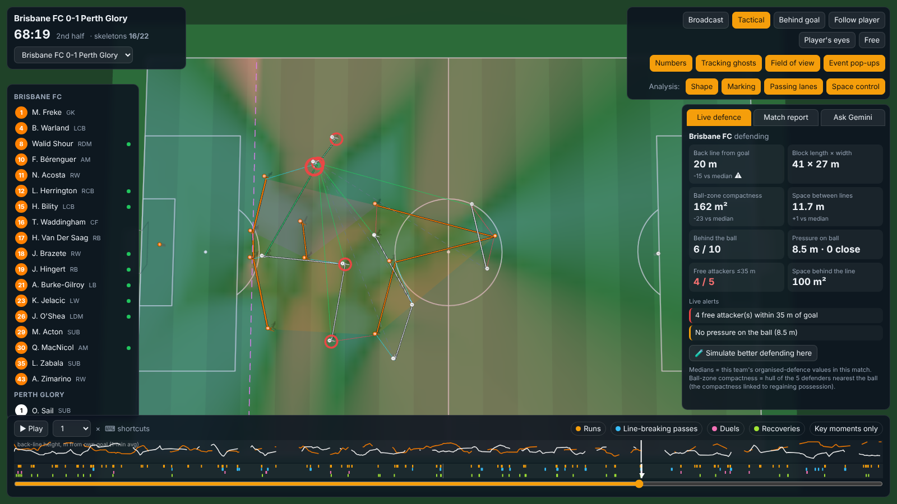
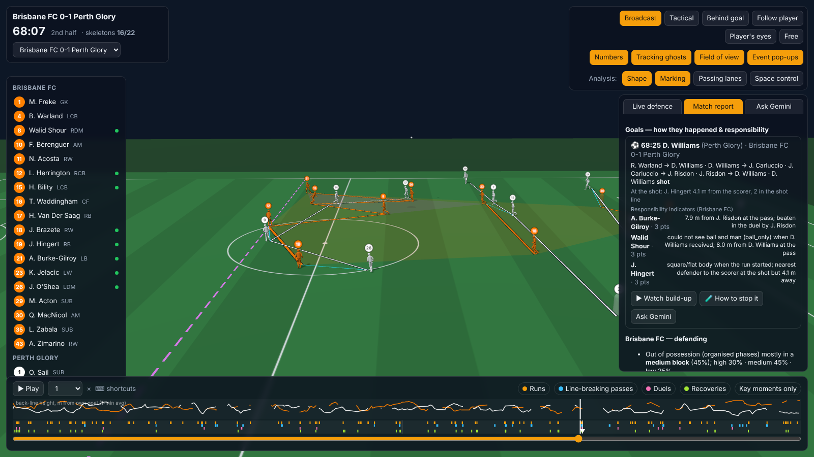
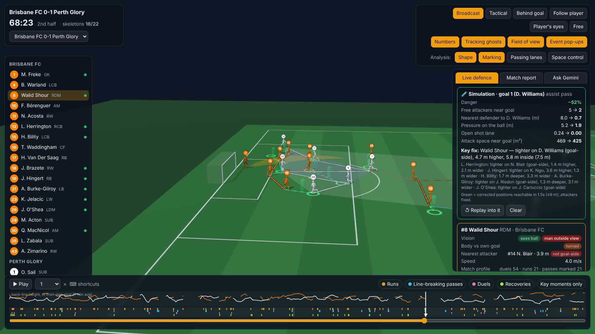

# Defensive Body Language — full framework reference

This document is the long-form companion to the README (which is limited to 1,000 words). Metric definitions and
thresholds mirror `dbl/framework.py` and `dbl/config.py`.

## 0. The framework is the 3D viewer with Gemini inside it

The deliverable for analysts is not a set of metrics: it is a **loop played on the real match**.

| Step | What the analyst does | What the system provides | Where |
|---|---|---|---|
| **Watch** | Plays the full match in 3D, picks a camera (incl. *Player's eyes*), selects a defender | Real skeletons at 12.5 fps, live overlays (shape, marking, lanes, space), event timeline | §11 |
| **Ask** | Types a question about what is on screen; follows up | Gemini with the frame as context, 17 read-only tools, conversation memory; answers jump the viewer to the cited moment | §12 |
| **Diagnose** | Reads the computed answer | Team shape layer (§12), body-language layer SEE-SHAPE-STANCE-REACT (§2–5), goal responsibility (§13) | §2–§13 |
| **Fix** | Asks "how could it be avoided?" | Counterfactual positions reachable within 1.5 s, drawn as green figures, with the key fix | §14 |

*Watch + Ask + Diagnose: the analyst asks about the first goal; the answer (sequence, shape at the shot,
responsibility indicators) comes from tools, and the viewer is already at the build-up.*

*Fix: the follow-up "How could it be avoided?" (no goal named — the chat remembers) runs the simulation and draws
the corrected positions on the pitch.*

Everything numeric is computed by the Python package; the LLM only selects tools, reads their JSON and writes the
explanation. The same tools power a deterministic offline mode, so the framework works without an API key.

## 1. Why body pose changes defensive analysis

Classical defensive metrics (PPDA, pressures, compactness, line height, pitch control) describe *positions*. Coaching feedback is mostly about *orientation and readiness*: where the defender is looking, how his hips are turned, whether he is loaded to move. Those were invisible until body pose. The framework keeps the coach's vocabulary and makes each cue a number measured at a defined moment, linked to an outcome, and reviewable on the pitch.

## 2. Principles

- **SEE** — Perception: does the defender gather the information he needs (ball, man, space behind)?
- **SHAPE** — Body orientation: is the body positioned to act on that information (side-on, open, showing the right way)?
- **STANCE** — Readiness: is the defender loaded (lower / more flexed than his own norm at that speed) when it matters?
- **REACT** — Response: how fast does the body turn and move when the threat appears, and does he recover after being beaten?

## 3. Metrics

### SEE
- **`vision`** (table `passes`) — cue: *See ball and man*. At the pass moment, are the ball and the receiver each within +/-60 deg of the receiver's marker's head heading (ear axis + nose vector)?
- **`shoulder_checks`** (table `passes`) — cue: *Check your shoulder*. Number of times the receiver's marker turned his head >75 deg away from the ball for >=0.12 s in the 3 s before the pass.
- **`ball_man_split_deg`** (table `passes`) — cue: *Get in a position to see both*. Angle between ball and receiver as seen from the marker. >120 deg: impossible to see both without turning -- a positioning problem, not a perception one.
- **`blind_side`** (table `runs`) — cue: *Don't ball-watch*. Run started outside the nearest defender's field of view while he was looking at the ball.
- **`runner_in_view`** (table `runs`) — cue: *Know where your runner is*. Runner within +/-60 deg of the defender's head heading at run start.

### SHAPE
- **`body_shape`** (table `duels|runs`) — cue: *Get side-on / open your body*. Duels: torso vs line to carrier (<25 square, 25-70 side-on, >70 turned). Runs: torso vs own goal (<45 turned, 45-135 open, >135 square/flat).
- **`body_angle`** (table `duels`) — cue: *Side-on in the duel*. Absolute angle between torso heading (shoulders+hips) and the line to the carrier.
- **`shows`** (table `duels`) — cue: *Show him outside / inside*. Side the defender's chest opens toward (the side he invites the carrier), mapped to touchline (outside) vs centre (inside).
- **`torso_to_goal_deg`** (table `runs`) — cue: *Open up to your own goal*. Angle between torso and the own-goal direction at run start (0 = facing own goal).

### STANCE
- **`loaded_stance`** (table `duels`) — cue: *Get low / on your toes*. Hip >=3 cm lower or knees >=5 deg more flexed than the player's own norm at the same running speed (gait-adjusted).
- **`hip_drop_m`** (table `duels`) — cue: *Get low*. Speed-adjusted hip-height residual (positive = lower than usual).
- **`approach_decel`** (table `duels`) — cue: *Slow down before you arrive*. Peak speed in the last 1 s minus speed at engagement (tracking).

### REACT
- **`reaction_lag_s`** (table `runs`) — cue: *React to the run*. Time between the runner and the defender each first reaching 2.5 m/s goal-ward.
- **`recovered`** (table `recoveries`) — cue: *Recover goal-side*. After being dribbled / run in behind, back between threat and goal within 3 s.
- **`turned_within_1s`** (table `recoveries`) — cue: *Turn and run*. Torso within 60 deg of own goal within 1 s of being beaten.

## 4. Outcomes

- **`receiver_free`** (`passes`): Receiver under no pressure at all at reception (SkillCorner overall_pressure_start = no_pressure).
- **`line_break`** (`passes`): Pass broke at least one defensive line (SkillCorner).
- **`pass_success`** (`passes`): Pass completed.
- **`lead_to_shot`** (`passes|runs`): Possession led to a shot.
- **`beaten_in_behind`** (`runs`): Runner started level/behind the defender and finished goal-side of him.
- **`dangerous`** (`runs`): SkillCorner 'dangerous' run.
- **`received`** (`runs`): Runner received the ball.
- **`regain`** (`duels`): Engagement ended in a direct/indirect regain.
- **`carrier_progressed`** (`duels`): Pressed carrier still shot, broke a line or passed forward.
- **`beaten`** (`duels`): Defender beaten by the carrier's possession or movement.
- **`recovered`** (`recoveries`): Back goal-side within 3 s.

## 5. Pre-registered comparisons

Each finding compares the outcome rate when the cue is present vs absent, stratified (Mantel–Haenszel-style weighted risk difference) by the listed context variables, with a 95% percentile bootstrap CI over moments. Results are written to `data/build/evidence.json` by `python -m dbl build`.

- `checks_line_break` (SEE): exposure *>=1 shoulder check in 3 s* → outcome `line_break`; strata ['third', 'marking_band']; filter `-`.
- `dual_vision_free` (SEE): exposure *ball AND man in view* → outcome `receiver_free`; strata ['third', 'marking_band']; filter `ball_man_split_deg <= 120`.
- `open_body_runs` (SHAPE): exposure *square/flat at run start* → outcome `beaten_in_behind`; strata ['third']; filter `forward_run`.
- `blind_side_runs` (SEE): exposure *run started on the blind side* → outcome `dangerous`; strata ['subtype']; filter `forward_run`.
- `loaded_regain` (STANCE): exposure *loaded stance* → outcome `regain`; strata ['subtype', 'third']; filter `-`.
- `side_on_progress` (SHAPE): exposure *side-on* → outcome `carrier_progressed`; strata ['subtype', 'distance_band']; filter `-`.
- `turn_recover` (REACT): exposure *turned within 1 s* → outcome `recovered`; strata ['source']; filter `-`.

*Stratified risk differences with 95 % bootstrap CIs for the pre-registered comparisons (numbers in
[RESULTS.md](RESULTS.md)).*

## 6. Thresholds (dbl/config.py)

- `max_joint_err_cm` = 18.0
- `shoulder_width_m` = (0.15, 0.6)
- `hip_width_m` = (0.1, 0.5)
- `fov_half_deg` = 60.0
- `check_away_deg` = 75.0
- `check_min_frames` = 3
- `scan_window_s` = 3.0
- `side_on_min_deg` = 25.0
- `side_on_max_deg` = 70.0
- `open_body_min_deg` = 45.0
- `ready_hip_drop_m` = 0.03
- `ready_knee_extra_deg` = 5.0
- `react_speed_mps` = 2.5
- `react_max_s` = 2.0
- `recover_window_s` = 3.0
- `engage_window_s` = 0.4
- `marker_max_dist_m` = 12.0

## 7. Pipeline

1. **Pose features** (`dbl/pose/extract.py`): stream each 3.3 GB JSON match, reduce each player-frame (25 fps) to torso/shoulder/hip/head headings, knee angle, hip height, stance width and foot stagger. Every angle is gated by the p90 joint error and plausible widths (adapted from SkillCorner's `pose_orientation.py`).
2. **Normalisation** (`dbl/moments/context.py`): coordinates and headings rotated so the defending team always defends x = −L/2. Velocities from Savitzky–Golay smoothing (SkillCorner recommends smoothing raw speeds).
3. **Posture norms**: match-wide hip-height and knee-angle medians per 0.5 m/s speed bin + per-player offsets; STANCE uses the residual.
4. **Marking**: Hungarian assignment of outfield defenders to attackers on distance to a point 2 m goal-side of each attacker (max 12 m).
5. **Moments** (`dbl/moments/build.py`): duels (on-ball engagements), passes (receiver's marker), runs (assigned/nearest defender), recoveries (after a beaten duel or a run getting in behind).
6. **Store & evidence** (`dbl/store.py`), **tools** for the LLM (`dbl/query/tools.py`), **agent** (`dbl/query/agent.py`), **app** (`app/streamlit_app.py`).

## 8. How analysts use it

- **Individual development**: Players tab → sort by `square_at_run` or `blind_side` → Moments tab filtered to that defender → clips for the session (minute + event id).
- **After an error**: Moments → recoveries → did he turn within 1 s, how long to get goal-side? Compare with his own baseline.
- **Opponent preparation**: Attack patterns → which runners start on blind sides, in which channel, and against which of our defenders.
- **Team principles**: Teams tab → dual vision, shoulder checks, receivers left free, beaten in behind; Ask tab for ad-hoc questions.

## 9. Limitations

- Two matches (~5k moments); associations, not causal effects; CIs resample moments not matches.
- Head yaw is a proxy for gaze; ±60° is a convention, not a measured visual field.
- Pose only for players visible in the broadcast; 59% of passes have both a marker and his pose.
- Reverse causality is possible (e.g. tighter marking situations may induce more checks); strata reduce but do not remove it.

## 10. References

- Bekkers, J. (2025). *Pressing Intensity: an intuitive measure for pressing in soccer.* arXiv:2501.04712.
- Spearman, W. (2018). *Beyond Expected Goals.* MIT Sloan Sports Analytics Conference.
- Fernández, J. & Bornn, L. (2018). *Wide Open Spaces.* MIT Sloan SAC.
- Groom, S. et al. (2026). *A Machine Learning Framework for Off Ball Defensive Role and Performance Evaluation in Football.* arXiv:2601.00748.
- U.S. Soccer Federation — *Visual exploratory behaviour* (SSAC 2026) open code.
- Wade, A. *Principles of Team Play / Defensive Play* (pressure, cover, balance, compactness, control & restraint).
- SkillCorner open data & body-pose tutorials (`src/features/pose_orientation.py`).

## 11. Full-match 3D viewer

`python -m dbl viewer` (or the *Match 3D* tab) serves a Three.js viewer from a local server (`dbl/viewer/`).

- **Data**: `python -m dbl fullmatch` keeps every resolved skeleton at 12.5 fps (23 joints, int16 cm, 10-minute parquet blocks, ~78 MB per match). The browser streams 30-second windows and interpolates to the display frame rate.
- **Who is drawn**: players with body pose at that instant are full skeletons (~14 of 22 on average, those visible in the broadcast). Everyone else is a translucent "ghost" placed from tracking.
- **Cameras**: broadcast (follows the ball), tactical (top-down), behind goal, follow player, **player's eyes** (camera at the selected player's head, looking along his head yaw — what he could see), free orbit.
- **Analysis layer**: the timeline shows framework moments (runs, line-breaking passes, duels, recoveries; "key" = beaten in behind / dangerous / led to shot / beaten / not recovered). Click a tick to jump to 3 s before and select the defender; pop-ups narrate moments while playing. The selected player gets a ±60° field-of-view cone projected from his head.
- **Deep links**: `/?match=1925299&f=30110&focus=560989&cam=follow&play=1` (f = tracking frame, 10 fps). The Moments tab in the app links straight into this view.
- **Moment clips** (Streamlit *Moments* tab) use the same skeletons for ±1.2 s around one moment:

*Left: open body, runner in view, no lag. Right: square and ball-watching; the runner (brown) starts outside the
cone, reaction 2.0 s late, beaten in behind.*

*Player's eyes: camera at the selected defender's head along his head yaw — what he could see.*

- **Typical workflow**: highest `square_at_run` defender → his square-and-beaten moments → open each in *Player's eyes* to see what he saw → clips for the session.

## 12. Defensive analysis layer (team shape, live overlays, report, Gemini)

What professional analysts read off the tactical camera, rebuilt from SkillCorner tracking + Dynamic Events and
shown on top of the 3D match (all computed, no LLM):

| Analyst question | Metric (dbl/shape.py, viewer/analysis.js) | Reference |
|---|---|---|
| How high / deep do they defend? | back-line height (deepest 4 outfielders, m from own goal), block height; block type mix from SkillCorner phases (high / medium / low block) | SkillCorner Phases of Play |
| Are they compact? | block length × width, convex-hull area of the 10 outfielders | Frencken et al. (2011); Low et al. (2020) |
| Compact **where it matters**? | ball-zone compactness: hull of the 5 defenders nearest the ball — the only compactness linked to defensive success | Forcher et al. / Univ. Vienna (2023), *Is a compact organization important for defensive success?* |
| Space between the lines | distance back line → next 3 players; alert > 15 m | coaching standard |
| Numbers behind the ball | outfielders goal-side of the ball; alert ≤ 5 | coaching standard |
| Pressure on the ball | nearest defender to the ball carrier, defenders within 5 m; carrier ring green/amber/red | Bekkers (2025) *Pressing Intensity* |
| Marking / free men | nearest defender per attacker (cyan = goal-side, rose = not); red pulsing ring = attacker inside 35 m with no defender within 5 m | Groom et al. (2026); Song et al. (2026) |
| Passing lanes | lanes from the carrier to team-mates, blocked if a defender is within 1.6 m (cover shadow); count of open forward lanes | AnalyticsFC (2021) *pass prevention* |
| Space conceded | simplified time-to-intercept pitch control (0.7 s reaction, 7 m/s, σ = 0.45): red = attack, blue = defence; **strong red = space the attack controls behind the defensive line** (+ m² shown live) | Spearman (2018); Fernández & Bornn (2018) |
| Team lines | each team's defence / midfield / attack lines in its kit colour (split at the two largest depth gaps, ≥2 players per line) | — |
| Offside line | pink dashed line at the second-last defender | — |
| Pressing intensity (match) | PPDA from SkillCorner engagements ending in regain / disruption / foul in the opponent's own two-thirds; passes per pressing engagement; counter-presses; pressing chains ending in a regain | Trainor (PPDA); Hudl/StatsBomb definitions — **no StatsBomb data used** |
| Penetration conceded | line-breaking passes conceded (any line / last line), shots conceded | SkillCorner Dynamic Events |

*All four overlays and the Live defence tab, 6 s before Perth's goal: back line 15 m deeper than usual, 4 free
attackers inside 35 m, nobody pressing the ball.*

**Live alerts** fire when a threshold is crossed (gap between lines, free attackers, not compact around the ball,
no pressure on the ball, ≥3 open forward lanes, ≤5 behind the ball). Each numeric tile is compared with the
same team's median in organised defence in that match (⚠ when 20% worse).

**Match report** (tab): per-team bullets (block mix, line height, compactness, free-man rate, PPDA, counter-press,
line breaks conceded, body-language profile), a KPI table and a clickable list of moments to review.

**Gemini in the viewer** (`POST /api/ask`): the question is sent with a `[CONTEXT]` block (match, tracking frame,
clock, selected player, and the live overlay state). Gemini can only call the typed tools (`defensive_state`,
`moments_window`, `match_insights`, `shape_by_phase`, `find_moments`, `aggregate`, `player_profiles`,
`framework_evidence`, ...) and is instructed to answer like an analyst: shape → key individual action → consequence →
coaching correction. Every tool call is listed under the answer. Without `GEMINI_API_KEY` (or if the Google API is
unreachable) a deterministic route answers *Explain this moment*, *What should he have done?*, *Match report* and
*How were they exploited?* from the same tools.

## 13. Goal-concession analysis ("how did it happen, who is responsible?")

`dbl/goals.py` finds every goal from SkillCorner's own flags (`game_interruption_after = goal_for`, `lead_to_goal`;
falls back to the score change) — validated against the match sheet's scorers. For each goal it rebuilds the
attacking chain (passes, line breaks, pressure on the ball), the conceding team's shape at the assist and the shot,
the situation at the shot (nearest defender to the scorer, distance, goal-side, defenders in the shot line) and a
**responsibility ranking** with explicit reasons from the framework moments in the build-up (beaten in behind,
vision failure at the reception, marking distance, no shoulder check, blind side, square body, late reaction, lost
duel, no recovery, scorer unmarked at the shot; weights doubled when the scorer/assister is involved). It is an
evidence-backed starting point for video review, not a verdict: tracking and pose cannot see the coach's instructions.

In the viewer: white triangles on the timeline mark goals (click = watch the build-up with the most responsible
defender selected); the *Match report* tab shows a card per goal; Gemini has `goals` and `goal_breakdown` tools and
the *Goals & who's responsible* quick question.

## 14. "How could it have been avoided?" — counterfactual simulation

`dbl/simulate.py` re-positions the defending outfield players at a chosen frame (by default the assist pass of a
goal) to minimise a danger objective, with **attackers and ball held fixed** and each defender constrained to where he
could physically have been: a disc around his position 1.5 s earlier with radius 6 m/s × 1.5 s = 9 m.

Objective = marking danger (threat-weighted attackers left uncovered; scorer and ball carrier weighted more;
not goal-side counts 60 %) + open ball→goal lane + attack-controlled threat-weighted space within 32 m of goal
(time-to-intercept pitch control) + a small movement penalty (prefer minimal corrections). Optimised by coordinate
descent on a polar grid inside each reachable disc. Output: before → after (free attackers, distance to the scorer,
pressure on the ball, shot lane, space near goal), % danger reduction, and the corrections ranked by marginal value
(**key fix** = the single most valuable move).

Example — goal 1, Brisbane 0–1 Perth (68:25): at the assist, Walid Shour stepping 7.5 m goal-side onto D. Williams is
the key fix; the full correction cuts modelled danger by 52 % (free attackers 5 → 2, nearest defender to the scorer
8.0 → 0.7 m, shot lane closed). Viewer: *🧪 How to stop it* on each goal card, *🧪 Simulate better defending here* in
Live defence, or ask Gemini; green figures and dashed arrows show the corrected positions.

Limits: attackers would also react; the model rates configurations, it does not replay the match. In the spirit of
positional-optimisation work from the first Analytics Cup (Shah, 2026), implemented independently.
