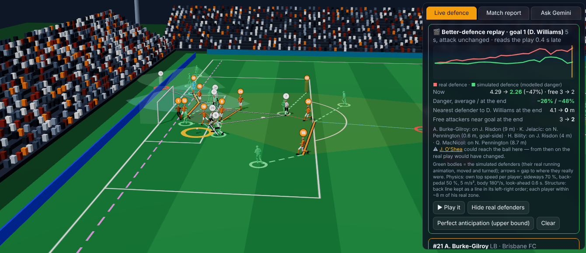

# Documentation

**The framework is the 3D match viewer with Gemini integrated**: Watch → Simulate the defence's movement → Find error
patterns → Train, on the real match (`python -m dbl viewer`). Start with the [user guide](USER_GUIDE.md) (illustrated) or section 0 of
[FRAMEWORK.md](FRAMEWORK.md).

| Document | For |
|---|---|
| [INSTALL.md](INSTALL.md) | Installing, downloading the data, building, running, Gemini, troubleshooting |
| [USER_GUIDE.md](USER_GUIDE.md) | How analysts use the 3D viewer, the Streamlit app, Gemini and the simulation; workflows |
| [FRAMEWORK.md](FRAMEWORK.md) | The SEE-SHAPE-STANCE-REACT framework, every metric, thresholds, team-shape layer, goals, simulation, references |
| [RESULTS.md](RESULTS.md) | All numbers: evidence, team profiles, match reports, every goal with responsibility and simulation, and §5 the **validation** of the simulation (passes, shots, kinematics, sensitivity) (generated) |
| [TRAINING.md](TRAINING.md) | Error patterns per team from the simulations and the training sessions built from them (generated) |
| [ARCHITECTURE.md](ARCHITECTURE.md) | Pipeline, modules, coordinate conventions, data schemas, HTTP API, LLM tools, how to extend |
| [DATA.md](DATA.md) | Data sources, rules, coverage and quality, limitations |
| [img/](img/) | Screenshots of the viewer used across the docs (captured with the offline router; with a Gemini key the answers carry the same tool results) |
