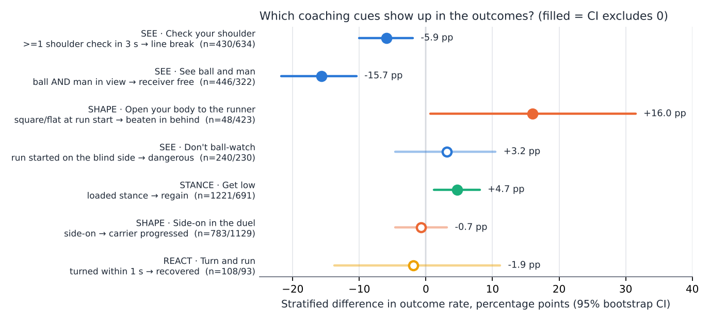

# Results

_Generated by `python -m dbl report` on 2026-10-14 from the built data. Two matches only: read every number as an association to prioritise video review, not as a causal effect._

## 1. Sample

| Moment family | Rows | With body pose |
|---|---|---|
| duels | 1,960 | 98% |
| passes | 1,789 | 59% |
| runs | 1,013 | 89% |
| recoveries | 206 | 98% |

## 2. Do the coaching cues show up in the outcomes?

Stratified risk difference (exposed − other), 95 % percentile bootstrap CI over moments (1,000 resamples).

| Principle | Cue | Exposure → outcome | Exposed | Other | Adjusted diff [95 % CI] | Strata |
|---|---|---|---|---|---|---|
| SEE | Check your shoulder | >=1 shoulder check in 3 s → line_break | 11.2% (n=430) | 16.6% (n=634) | **-5.9%** [-10.1%, -2.0%] | third, marking_band |
| SEE | See ball and man | ball AND man in view → receiver_free | 14.3% (n=446) | 32.0% (n=322) | **-15.7%** [-21.8%, -10.4%] | third, marking_band |
| SHAPE | Open your body to the runner | square/flat at run start → beaten_in_behind | 41.7% (n=48) | 25.5% (n=423) | **+16.0%** [+0.6%, +31.5%] | third |
| SEE | Don't ball-watch | run started on the blind side → dangerous | 53.8% (n=240) | 41.3% (n=230) | **+3.2%** [-4.6%, +10.5%] | subtype |
| STANCE | Get low | loaded stance → regain | 19.2% (n=1221) | 14.2% (n=691) | **+4.7%** [+1.2%, +8.1%] | subtype, third |
| SHAPE | Side-on in the duel | side-on → carrier_progressed | 20.2% (n=783) | 22.5% (n=1129) | **-0.7%** [-4.6%, +3.1%] | subtype, distance_band |
| REACT | Turn and run | turned within 1 s → recovered | 37.0% (n=108) | 38.7% (n=93) | **-1.9%** [-13.7%, +11.1%] | source |

## 3. Team defensive profiles

| team | side_on | loaded | regain | dual_vision | checks_per_pass | receiver_free | blind_side_runs | square_at_run | beaten_in_behind | reaction_lag_s |
|---|---|---|---|---|---|---|---|---|---|---|
| Adelaide United | 0.41 | 0.64 | 0.13 | 0.52 | 0.58 | 0.22 | 0.58 | 0.07 | 0.26 | 0.30 |
| Brisbane FC | 0.47 | 0.58 | 0.25 | 0.51 | 0.61 | 0.31 | 0.43 | 0.12 | 0.20 | 0.42 |
| Perth Glory | 0.41 | 0.66 | 0.16 | 0.48 | 0.61 | 0.43 | 0.47 | 0.13 | 0.29 | 0.51 |
| Sydney FC | 0.37 | 0.66 | 0.19 | 0.53 | 0.62 | 0.22 | 0.53 | 0.10 | 0.30 | 0.34 |

### Brisbane FC 0-1 Perth Glory

**Brisbane FC — defending**
- Out of possession (organised phases) mostly in a **medium block** (45%); high 30% · medium 45% · low 25%.
- Back line **38 m** from goal (opponent 30 m); block length 30 m × width 33 m, area 688 m².
- Ball-zone compactness (5 nearest defenders): **180 m²** (opponent 162 m²) — the compactness that predicts winning the ball back.
- Space between lines: **10.9 m** median; 8 outfielders goal-side of the ball.
- An attacker was free (no defender within 5 m) inside 35 m of goal in **37%** of organised-defence time.
- PPDA **3.3** (opponent passes in their own two-thirds per regain/disruption/foul there; lower = more aggressive) · 1.02 passes per pressing engagement; 31 counter-presses, 47 pressing chains ending in a regain, 89 regains.
- Line-breaking passes conceded: **46** of 329 opponent passes (14%); 8 broke the last line; opponent shots 11.
- Body language: marker saw ball **and** man on 51% of passes, 0.61 shoulder checks per pass; 43% of forward runs started on a defender's blind side; square body at 12% of runs; beaten in behind 20%.

**Perth Glory — defending**
- Out of possession (organised phases) mostly in a **medium block** (46%); high 13% · medium 46% · low 40%.
- Back line **30 m** from goal (opponent 38 m); block length 26 m × width 33 m, area 604 m².
- Ball-zone compactness (5 nearest defenders): **162 m²** (opponent 180 m²) — the compactness that predicts winning the ball back.
- Space between lines: **9.5 m** median; 9 outfielders goal-side of the ball.
- An attacker was free (no defender within 5 m) inside 35 m of goal in **49%** of organised-defence time.
- PPDA **4.1** (opponent passes in their own two-thirds per regain/disruption/foul there; lower = more aggressive) · 0.86 passes per pressing engagement; 31 counter-presses, 47 pressing chains ending in a regain, 91 regains.
- Line-breaking passes conceded: **91** of 583 opponent passes (16%); 5 broke the last line; opponent shots 19.
- Body language: marker saw ball **and** man on 48% of passes, 0.61 shoulder checks per pass; 47% of forward runs started on a defender's blind side; square body at 13% of runs; beaten in behind 29%.

| Team | PPDA* | Counter-presses | Pressing chains → regain | Regains | Line breaks conceded | Last-line breaks | Shots conceded |
|---|---|---|---|---|---|---|---|
| Brisbane FC | 3.3 | 31 | 47 | 89 | 46 / 329 | 8 | 11 |
| Perth Glory | 4.1 | 31 | 47 | 91 | 91 / 583 | 5 | 19 |

_*PPDA from SkillCorner engagements ending in regain/disruption/foul — not comparable with event-provider PPDA._

### Sydney FC 4-1 Adelaide United

**Sydney FC — defending**
- Out of possession (organised phases) mostly in a **medium block** (44%); high 31% · medium 44% · low 25%.
- Back line **38 m** from goal (opponent 32 m); block length 30 m × width 35 m, area 696 m².
- Ball-zone compactness (5 nearest defenders): **164 m²** (opponent 157 m²) — the compactness that predicts winning the ball back.
- Space between lines: **11.2 m** median; 8 outfielders goal-side of the ball.
- An attacker was free (no defender within 5 m) inside 35 m of goal in **38%** of organised-defence time.
- PPDA **4.4** (opponent passes in their own two-thirds per regain/disruption/foul there; lower = more aggressive) · 1.06 passes per pressing engagement; 50 counter-presses, 96 pressing chains ending in a regain, 89 regains.
- Line-breaking passes conceded: **68** of 396 opponent passes (17%); 17 broke the last line; opponent shots 14.
- Body language: marker saw ball **and** man on 53% of passes, 0.62 shoulder checks per pass; 53% of forward runs started on a defender's blind side; square body at 10% of runs; beaten in behind 30%.

**Adelaide United — defending**
- Out of possession (organised phases) mostly in a **medium block** (41%); high 22% · medium 41% · low 37%.
- Back line **32 m** from goal (opponent 38 m); block length 31 m × width 35 m, area 707 m².
- Ball-zone compactness (5 nearest defenders): **157 m²** (opponent 164 m²) — the compactness that predicts winning the ball back.
- Space between lines: **10.6 m** median; 7 outfielders goal-side of the ball.
- An attacker was free (no defender within 5 m) inside 35 m of goal in **47%** of organised-defence time.
- PPDA **3.7** (opponent passes in their own two-thirds per regain/disruption/foul there; lower = more aggressive) · 0.74 passes per pressing engagement; 52 counter-presses, 71 pressing chains ending in a regain, 76 regains.
- Line-breaking passes conceded: **72** of 482 opponent passes (15%); 8 broke the last line; opponent shots 16.
- Body language: marker saw ball **and** man on 52% of passes, 0.58 shoulder checks per pass; 58% of forward runs started on a defender's blind side; square body at 7% of runs; beaten in behind 26%.

| Team | PPDA* | Counter-presses | Pressing chains → regain | Regains | Line breaks conceded | Last-line breaks | Shots conceded |
|---|---|---|---|---|---|---|---|
| Sydney FC | 4.4 | 50 | 96 | 89 | 68 / 396 | 17 | 14 |
| Adelaide United | 3.7 | 52 | 71 | 76 | 72 / 482 | 8 | 16 |

_*PPDA from SkillCorner engagements ending in regain/disruption/foul — not comparable with event-provider PPDA._

## 4. Goals: how they happened, responsibility, and how they could have been prevented

### Brisbane FC 0-1 Perth Glory

**Goal 1 — 68:25 D. Williams (Perth Glory)**, assist J. Risdon · Brisbane FC 0-1 Perth Glory
- Build-up: T. Gomulka → R. Warland → D. Williams → J. Carluccio → J. Risdon → D. Williams (shot)
- At the shot: nearest defender J. Hingert at 4.1 m (goal-side), 2 in the shot line, shot from 9.6 m
- Responsibility indicators: **A. Burke-Gilroy** 3 pts (7.9 m from J. Risdon at the pass, beaten in the duel by J. Risdon); **Walid Shour** 3 pts (could not see ball and man (ball_only) when D. Williams received, 8.0 m from D. Williams at the pass); **J. Hingert** 3 pts (square/flat body when the run started, nearest defender to the scorer at the shot but 4.1 m away)
- Simulation at the assist pass: danger **−52%**, free attackers 5 → 2, nearest defender to the scorer 8.0 → 0.7 m; key fix: **Walid Shour** — tighter on D. Williams (goal-side), 4.7 m higher, 5.8 m inside (7.5 m)

### Sydney FC 4-1 Adelaide United

**Goal 1 — 35:27 J. Lolley (Sydney FC)**, assist P. Klimala · Sydney FC 1-0 Adelaide United
- Build-up: Léo Sena → A. Cáceres → J. Lolley → A. Cáceres → P. Klimala → J. Lolley (shot)
- At the shot: nearest defender J. Barnett at 3.4 m (goal-side), 1 in the shot line, shot from 15.9 m
- Responsibility indicators: **J. Barnett** 3 pts (line-breaking pass R. Grant → Léo Sena while he was the receiver's marker, nearest defender to the scorer at the shot but 3.4 m away); **B. Vriends** 3 pts (could not see ball and man (ball_only) when P. Klimala received, no shoulder check in the 3 s before the pass); **Z. Clough** 3 pts (could not see ball and man (neither) when J. Lolley received, 7.3 m from J. Lolley at the pass)
- Simulation at the assist pass: danger **−29%**, free attackers 4 → 2, nearest defender to the scorer 7.1 → 0.8 m; key fix: **J. Barnett** — tighter on J. Lolley (goal-side), 3.3 m higher, 6.9 m wider (7.7 m)

**Goal 2 — 45:16 P. Klimala (Sydney FC)**, assist J. Lolley · Sydney FC 2-0 Adelaide United
- Build-up: P. Klimala → Léo Sena → C. Hollman → J. Lolley → P. Klimala (shot)
- At the shot: nearest defender B. Vriends at 1.6 m (not goal-side), 0 in the shot line, shot from 7.8 m
- Responsibility indicators: **J. Yull** 6 pts (square/flat body when the run started, reacted 2.0 s after the runner); **B. Vriends** 5 pts (could not see ball and man (neither) when P. Klimala received, beaten in the duel by P. Klimala); **F. Talladira** 3 pts (could not see ball and man (ball_only) when J. Lolley received, no shoulder check in the 3 s before the pass)
- Simulation at the assist pass: danger **−24%**, free attackers 3 → 1, nearest defender to the scorer 0.5 → 0.5 m; key fix: **S. Mauk** — tighter on C. Hollman (goal-side), 2.0 m higher, 3.1 m inside (3.7 m)

**Goal 3 — 48:51 D. Pierias (Adelaide United)** · Sydney FC 2-1 Adelaide United
- Build-up: D. Pierias (shot)
- At the shot: nearest defender K. Shaw at 1.9 m (not goal-side), 0 in the shot line, shot from 16.3 m
- Simulation at the 1 s before the shot: danger **−4%**, free attackers 1 → 1, nearest defender to the scorer 3.9 → 2.8 m; key fix: **K. Shaw** — tighter on D. Pierias, 1.2 m higher, 2.2 m wider (2.6 m)

**Goal 4 — 74:34 A. Segecic (Sydney FC)**, assist J. Lolley · Sydney FC 3-1 Adelaide United
- Build-up: C. Hollman → A. Segecic → Léo Sena → A. Ouahim → J. Lolley → A. Segecic (shot)
- At the shot: nearest defender D. Pierias at 5.2 m (goal-side), 1 in the shot line, shot from 6.5 m
- Responsibility indicators: **F. Talladira** 6 pts (could not see ball and man (ball_only) when J. Lolley received, 7.1 m from J. Lolley at the pass); **Y. Dukuly** 2 pts (reacted 1.1 s after the runner); **D. Pierias** 2 pts (nearest defender to the scorer at the shot but 5.2 m away)
- Simulation at the assist pass: danger **−9%**, free attackers 4 → 1, nearest defender to the scorer 1.4 → 1.4 m; key fix: **D. Pierias** — tighter on J. Courtney-Perkins, 6.5 m higher, 5.4 m wider (8.5 m)

**Goal 5 — 82:51 A. Cáceres (Sydney FC)**, assist A. Segecic · Sydney FC 4-1 Adelaide United
- Build-up: Léo Sena → Douglas Costa → J. Courtney-Perkins → A. Cáceres → A. Segecic → A. Cáceres (shot)
- At the shot: nearest defender Z. Clough at 4.6 m (not goal-side), 1 in the shot line, shot from 24.2 m
- Responsibility indicators: **Z. Clough** 4 pts (6.9 m from A. Cáceres at the pass, no shoulder check in the 3 s before the pass); **P. Kikianis** 3 pts (11.3 m from A. Segecic at the pass, no shoulder check in the 3 s before the pass); **B. Vriends** 2 pts (could not see ball and man (ball_only) when A. Cáceres received)
- Simulation at the assist pass: danger **−33%**, free attackers 3 → 2, nearest defender to the scorer 3.3 → 0.4 m; key fix: **F. Talladira** — tighter on J. Lolley (goal-side), 2.9 m higher, 4.2 m wider (5.1 m)

Reading the simulation: a large reduction means the goal was preventable by positioning within the reaction window; a small one (< 10 %) means the defence was already near its best reachable shape and the goal came from elsewhere (finishing, an individual action, a set-piece second ball).
