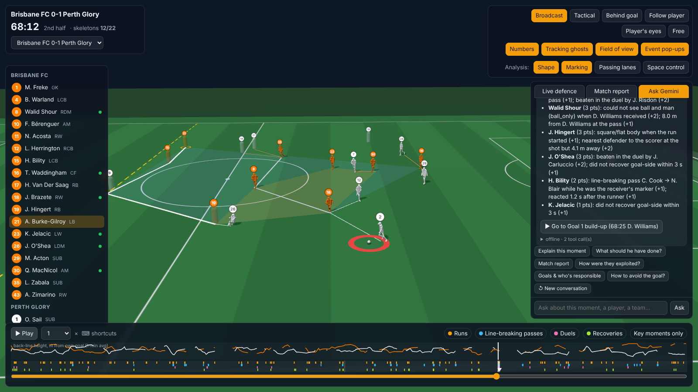
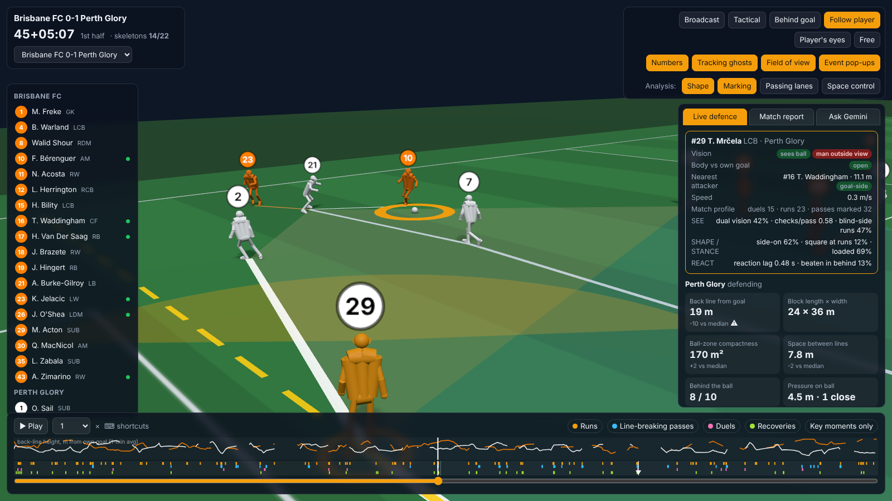
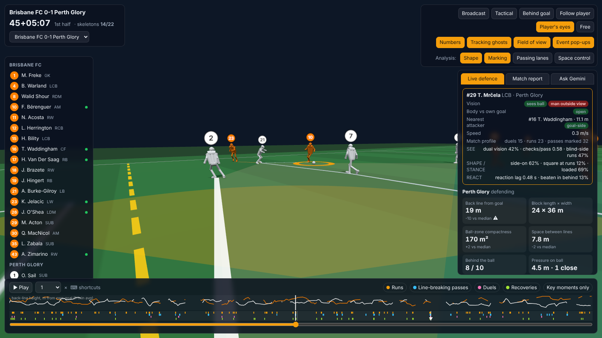
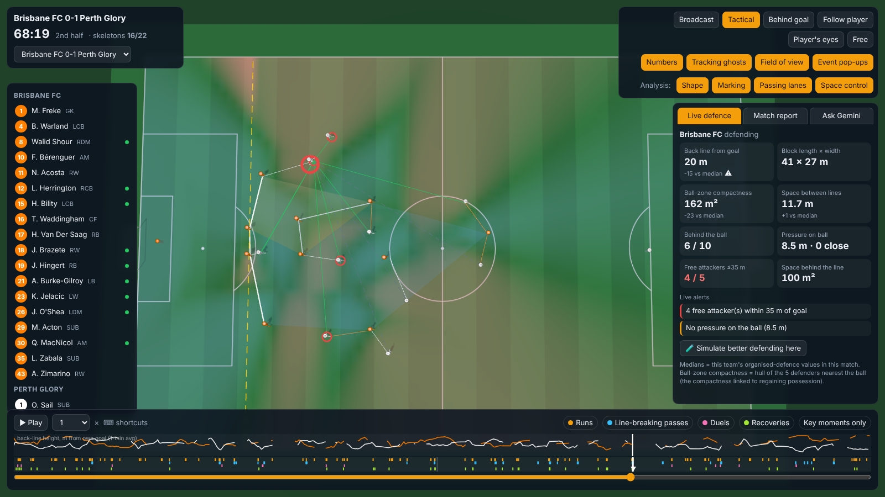
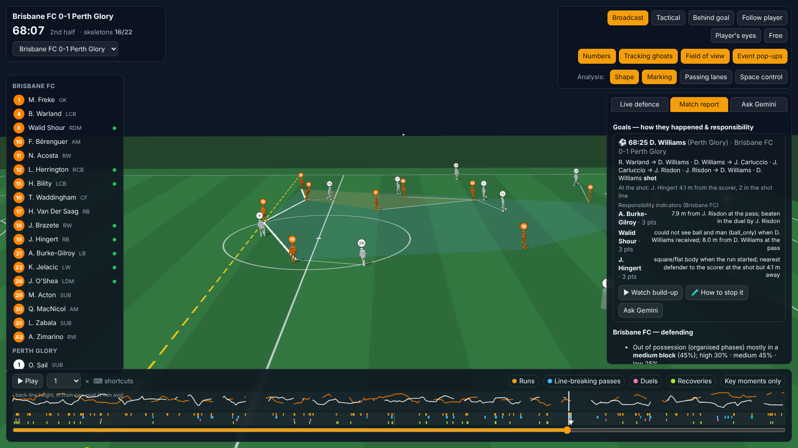
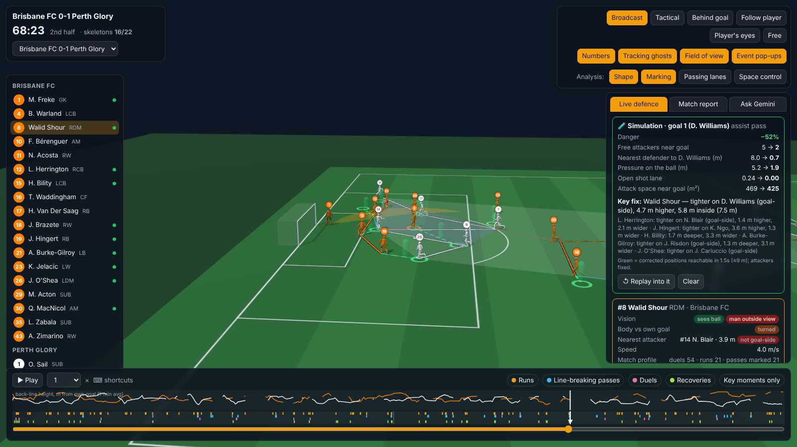
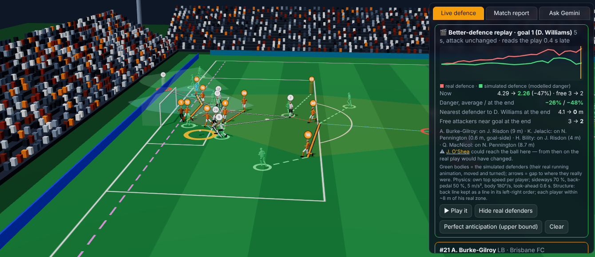
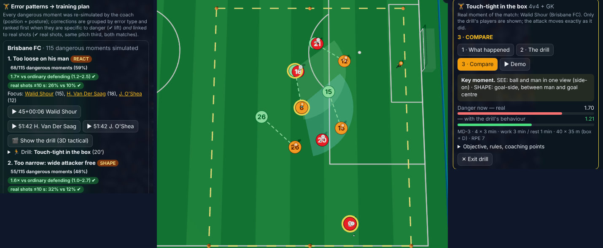
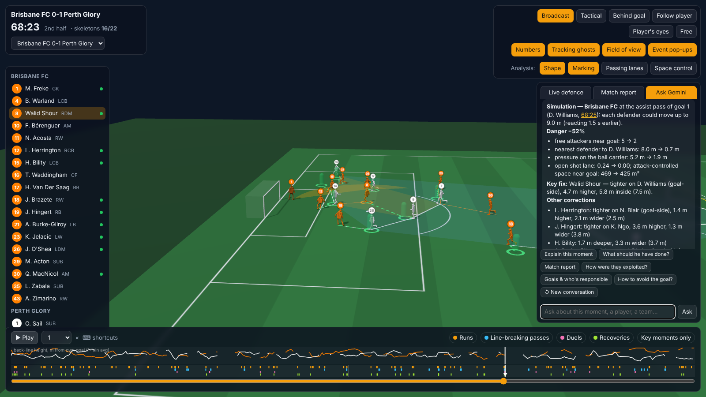

# User guide — how an analyst uses Defensive Body Language

Two interfaces share the same data and tools:

- **3D match viewer** (`python -m dbl viewer`, http://localhost:8765): watch a whole match with real skeletons and
  live defensive analysis, ask Gemini about what you are watching, simulate better defending.
- **Streamlit app** (`python -m dbl app`): tables, filters, profiles, evidence, 3D/2D clips of single moments; it
  embeds the viewer in the *Match 3D* tab.

The **framework is the viewer with Gemini inside it**: a loop of *Watch → Ask → Diagnose → Fix → Train* on the real match.

*"How did the first goal happen and who is responsible?" → sequence, shape at the shot and responsibility indicators per defender, with a "▶ Go to" button. The viewer is already at the build-up.*

---

## 1. The 3D match viewer

### 1.1 Screen layout

| Area | What it shows |
|---|---|
| Top-left | Match selector, match clock (`45+05:07` = stoppage time), number of players with a skeleton right now |
| Left | Squads. Click a player to select him (shirt and shorts turn to a highlight colour chosen to differ from both kits, + field-of-view cone). Green dot = body pose available at this instant |
| Top-right | Cameras, display toggles, **Analysis** overlay toggles |
| Right panel | **Live defence** · **Match report** · **Ask Gemini** |
| Bottom | Play/pause, speed (0.25×–8×), back-line height chart of both teams, event timeline, scrubber |

*Follow player (#29 Mrčela, Perth): orange = Brisbane, white = Perth; the yellow cone is his ±60° field of view. The card on the right is the selected-player read-out.*

Players with body pose are drawn as **skeletons** (12.5 fps, interpolated). The others — not visible on the TV Each body is a solid torso (oriented by shoulders and hips) with limbs and head from the 23 joints. The ball sits on the grass unless the tracking says it is clearly in the air (> 0.45 m; broadcast ball height is noisy near the ground); its shadow grows and fades with height.
broadcast at that moment — are **translucent ghosts** placed from tracking (10 fps).

### 1.2 Cameras

| Camera | Use it for |
|---|---|
| Broadcast | Following the ball like TV (default) |
| Tactical | Top-down: team shape, lines, space |
| Behind goal | Depth of the back line, runs in behind |
| Follow player | Camera behind the selected player, looking at the ball |
| **Player's eyes** | Camera at the selected player's head, looking where his head points — *what could he see?* |
| Free | Orbit/zoom with the mouse (any drag switches to Free) |

*Player's eyes: the same instant seen from Mrčela's head. He sees the ball; his man (Waddingham, 11 m away) is outside his view.*

Keyboard: `Space` play/pause · `←/→` ±5 s · `,`/`.` ±1 frame · `1`–`6` cameras · double-click a player on the pitch to select him.

### 1.3 Analysis overlays (toggle in *Analysis:*)

| Overlay | Drawn on the grass | How to read it |
|---|---|---|
| **Shape** | **Each team's lines in its own kit colour** (e.g. orange = Brisbane, white = Perth; light blue = Sydney, yellow = Adelaide): defence, midfield and attack line of both teams, detected from the depth gaps (adapts to 4-4-2, 4-3-3, 5-3-2…), the defending team drawn thicker; the defending block filled in its colour; pink dashed **offside line**; violet hull of the 5 defenders nearest the ball | Gaps between lines, block height, compactness *around the ball* |
| **Marking** | Line from each attacker to his nearest defender (cyan = defender goal-side, rose = not); **pulsing red ring** = attacker inside 35 m with no defender within 5 m; ring on the ball carrier (green ≤2.5 m pressure, amber ≤5 m, red >5 m) | Who is free, who is marked from the wrong side, is the ball pressed |
| **Passing lanes** | From the ball carrier to each team-mate: solid green = open, grey dashed = blocked by a defender within 1.6 m | Cover shadows, open forward options |
| **Space control** | Heatmap: red = attack arrives first, blue = defence; **strong red = space the attack controls behind the defensive line** | Space conceded, especially behind the line |

*Tactical camera, 68:19, all four overlays on, seconds before Perth's goal. Brisbane's lines in orange (defending, thicker), Perth's in white. Live defence flags it: back line 15 m below Brisbane's median, 4 free attackers within 35 m, no pressure on the ball (8.5 m).*

Display toggles: Numbers (shirt numbers), Tracking ghosts, Field of view (cone of the selected player), Event
pop-ups (framework moments narrated while playing).

### 1.4 Right panel

**Live defence** (updates 4× per second)
- Defending team and 8 tiles: back-line height, block length × width, ball-zone compactness, space between lines,
  outfielders behind the ball, pressure on the ball, free attackers ≤35 m, space behind the line (with Space control on).
  Each tile is compared with that team's median in organised defence in this match (⚠ when ≥20 % worse).
- **Live alerts**: gap between lines > 15 m, free attackers, not compact around the ball, no pressure on the ball,
  ≥3 open forward lanes, ≤5 behind the ball.
- **Selected player card**: does he see the ball / his man (head ±60°), body vs own goal (open / square / turned),
  nearest attacker and whether he is goal-side, speed, and his SEE-SHAPE-STANCE-REACT profile.
- **🧪 Simulate better defending here**: runs the counterfactual at the current frame (section 1.6).

**Match report**

- One card per **goal**: build-up, situation at the shot, responsibility indicators, and buttons
  *▶ Watch build-up*, *🧪 How to stop it*, *Ask Gemini*.
- Per-team defensive report (block mix, line height, compactness, free-man rate, PPDA, counter-pressing, line
  breaks conceded, body language), KPI table, and clickable *Moments to review*.

**Ask Gemini** — see 1.7.

### 1.5 Timeline

- Coloured ticks: runs (orange), line-breaking passes (blue), duels (pink), recoveries (green). *Key moments only*
  keeps the ones that ended badly (beaten in behind, dangerous, led to a shot, duel lost, no recovery).
- **White triangles = goals.** Click one to watch the build-up with the most responsible defender selected.
- Hover for a description; click a tick to jump 3 s before it with the defender selected.
- The chart above shows each team's back-line height (1-minute average) through the match.

### 1.6 "How could it be avoided?" — the simulation

Click *🧪 How to stop it* on a goal card (or *Simulate better defending here*, or ask Gemini). The viewer pauses at
the assist pass and shows:

- **green bodies + dashed arrows**: each defender's *own skeleton*, moved, turned and lowered as suggested, animated
  from where he really was; a **green cone** shows where he should have been looking;
- a **Simulation** card: danger reduction, split into *position alone* vs *posture alone* (body, head, stance), free
  attackers, distance to the scorer, pressure on the ball, defenders seeing ball + man, open shot lane, attack space
  near goal — before → after — and the **key fix** with its reason (e.g. *"tighter on Williams (goal-side)"*,
  *"open the body: square → open (reacts 1.07 → 0.49 s)"*, *"head 40° left: ball and Klimala in view"*, *"get low on
  the ball carrier"*).
- **🎯 What should he have done?** (Live defence, with a player selected): the same coach for that one defender, with
  everybody else as they were.

*Goal 1 simulation (screenshot from the position-only version; the posture-aware model gives −46 %, almost all from position): free attackers 5 → 2, nearest defender to the scorer 8.0 → 0.7 m; key fix Walid Shour goal-side of Williams.*

Rules: each defender can only reach where he could have been if he had reacted 1.5 s earlier (≤ 9 m at 6 m/s);
heads turn at most 75° from the torso; attackers are held fixed. A big reduction means positioning/posture could have
prevented it; < 10 % means the defence was already near its best reachable shape. *↺ Replay into it* rewinds 4 s so
you see the moment arrive.

#### 🎬 Better-defence replay — move everybody, up to 5 s

*🎬 Better defence (5 s)* on a goal card, *🎬 Re-play 5 s* on the simulation card, or *🎬 Better defence, next 5 s*
in Live defence. The server re-simulates every defender's movement (≈ 20 s, then cached) and the viewer plays it:

- **What you see.**
  - The attack and the ball are exactly what happened.
  - **Green bodies** are the simulated defenders, animated with each player's own running clip at the simulated
    speed and heading.
  - **Dashed arrows** show the gap to where they really were.
  - **Hide real defenders** leaves only the simulated defence. Lines, marking, free men and space are then
    recomputed on it.
- **The card.**
  - The **danger curve**, real (red) vs simulated (green), with the cursor at the current instant.
  - Danger now / on average / at the shot, free attackers, and the nearest defender to the scorer.
  - Who would have defended most differently (the man he ends on, goal-side or not).
  - Warnings when a simulated defender could reach the ball. From there the real play would have changed.
- **Realism.**
  - By default the defenders read the play **0.4 s late** and extrapolate it.
  - *Perfect anticipation* shows the upper bound when they "know" the future.
  - Physics per player: his own top speed, slower sideways (70 %) and back-pedalling (50 %), 5 m/s², body 180°/s,
    head 360°/s; no sideways sprinting.
  - Structure: the back line stays a line in its order; each player stays within ~8 m of his real zone.
  - The green players run with **their own running clips** at the simulated speed (no sliding).

#### 🏋️ Error patterns → training plan (Match report tab)

The top of *Match report* shows, for each team, the **recurring errors** found by re-simulating every dangerous
moment it faced: line-breaking passes, shot possessions, dangerous runs, runs in behind and duels lost (≈ 110–170 per
team).

- **How each priority is built.** Every correction the coach proposes is tagged with an error type:
  - lost goal-side, too loose on his man, no pressure on the ball;
  - line too high / too deep, too wide / too narrow, not covering space;
  - ball-watching, square body, upright.
- **What each priority shows.**
  - **Evidence badges:** how often; the **lift** vs ordinary defending (95 % CI; ✔ when it excludes 1); and
    **real shots ≤ 10 s**, how often the attack really shot within 10 s when the coach flags this error vs when it
    does not (same pitch third, both matches; ✔ when the CI excludes 0). Hover for the full sentence.
  - **Players to focus** on (click to select).
  - **▶ example clips**: they jump to the moment and run the coach for that defender.
  - A **drill**: objective, setup, rules, coaching points in SEE / SHAPE / STANCE / REACT terms, progression, and the
    **KPI to track** in the next match.
- **Ranking.** Errors with both ✔ (specific to danger *and* linked to real shots) come first, then those with one,
  then by the avoidable danger that is specific to dangerous moments. Example clips are taken in the drill's zone
  (the final third for marking drills) when the team has one.
- **📋 Session sheet.** A printable page (Print / PDF) for the coaching staff: microcycle day, load (sets × reps,
  work:rest, space, numbers, RPE), and for every drill a **pitch diagram of the real situation from the match**
  (attack, defence, ball, and the coach's corrections as green arrows) to set the drill up from.
- **🎬 Show the drill (3D tactical).** The 3D viewer switches to a tactical camera framed on the drill area and
  replays the real moment of the match with only the drill's players, as big numbered counters on the grass:
  - drill area, cones and gates (or the line band for line drills);
  - the attack moving exactly as it did;
  - the defenders in three modes: **1 · what happened** (kit colour), **2 · the drill** (green, moving as the coach
    corrects, with body orientation), **3 · compare** (arrows from the real to the corrected position);
  - *Demo* alternates 1 → 2;
  - timed coaching captions, the danger of the situation (real vs drill), set-up, load and KPI.
  *Exit* restores the camera and overlays. The printable session sheet links each drill to this view.
- **Full plans.** The complete plans, with the session outline, are in [TRAINING.md](TRAINING.md). Ask Gemini:
  *"What should Brisbane train this week?"*

#### ✎ Try your own — teach a different action

*✎ Try your own* turns the simulation into an editor:
- The camera switches to **Tactical** (top-down) and a green banner explains the controls.
- Every defender gets a **green grab handle**. The editor starts from **what happened**, so each change you make
  appears as a green player of its own. *Load the auto coach* starts from the suggestion instead.

| Action | Effect |
|---|---|
| **Drag** a handle | moves the defender; he cannot leave his green reach circle (where he could be reacting 1.5 s earlier) |
| **Q / E** or ↺/↻ body | turn his body 15° (head follows) |
| **Z / C** or ↺/↻ head | turn only his head 15° (max 75° from the body) |
| **L** or *stance* | toggle loaded / upright stance |
| **R** or *undo* | undo that player · **Esc** / *Done* leave the editor (camera restored) |

Every change is re-scored by the server in ~50 ms: *Your version* shows danger vs what happened (and vs the
automatic coach), free attackers, pressure on the ball, defenders seeing ball + man, and for the edited player whether
he sees the ball and his man, his body shape and its reaction time, and his stance. Use it in video sessions: let the
player propose where he should have been, then show the number.

### 1.7 Ask Gemini — the analyst assistant

Every question is sent with what you are watching: match, frame, clock, selected player, the live overlay state,
the defensive state at that frame, the nearby framework moments and the list of goals. Gemini answers by calling
read-only tools (listed under each answer) — it never invents numbers.

*Follow-up "How could it be avoided?" — no need to repeat which goal: the chat remembers. The answer draws the corrected positions on the pitch.*

- **Memory**: the conversation is remembered (including the data already retrieved), so follow-ups work:
  *"How did the first goal happen?"* → *"who is to blame?"* → *"how could it be avoided?"* → *"and the second one?"*.
  *↺ New conversation* starts fresh (changing match also resets).
- **It moves the viewer**: answers about a goal jump to its build-up and play it; times like **68:23** in an answer
  are clickable; a *▶ Go to…* button replays the moment; simulation answers draw the green corrected positions.
- Quick questions: *Explain this moment*, *What should he have done?*, *Match report*, *How were they exploited?*,
  *Goals & who's responsible*, *How to avoid the goal?*.
- Offline (no key / blocked network): the same quick questions are answered deterministically from the tools.

Good questions:
- "Explain this moment defensively."
- "Why was Williams free at 68:23?"
- "Which Brisbane defender gets caught square most often when runs start? Show me the moments."
- "Compare the two teams' block height and compactness in low block."
- "How did Sydney exploit Adelaide's defence?"

---

## 2. The Streamlit app

| Tab | Content |
|---|---|
| Framework | SEE-SHAPE-STANCE-REACT, evidence table (stratified risk differences with CIs), metric dictionary |
| Teams | Team body-language profile |
| Players | Per-defender profile, sortable (e.g. `square_at_run`, `blind_side`, `dual_vision`) |
| Moments | Filter any moment family by team/defender/category or a pandas query; click a row for a **3D clip** (real skeletons ±1.2 s) or 2D pitch, and *▶ Watch in full-match 3D viewer* |
| Match 3D | The full viewer embedded |
| Attack patterns | Runners who start on blind sides, by channel; receivers fed while their marker could not see ball and man |
| Ask (Gemini) | Same assistant, with memory |

Example pandas queries in *Moments*: `blind_side == 1 and beaten_in_behind == 1`, `vision == 'ball_only' and line_break`,
`body_shape == 'square' and distance_m < 3`.

---

## 3. Analyst workflows

**Post-match review (30 min)**
1. *Match report* → read the goal cards; *▶ Watch build-up* each goal in *Player's eyes* on the key defender.
2. *🧪 How to stop it* → screenshot the corrected shape for the video session.
3. *Moments to review* → 5–8 clips of beaten-in-behind / not-recovered moments.

**Individual development**
1. Streamlit *Players* → sort by `square_at_run` or `blind_side`.
2. *Moments* filtered to that defender → open each in the viewer, *Player's eyes*.
3. Show him the green simulation of his best position.

**Opponent preparation**
1. *Attack patterns* → which of their runners start on defenders' blind side, in which channel.
2. Viewer → Space control + Passing lanes on their build-up to see where they find space behind lines.
3. Ask: *"How did they exploit the defence?"*.

**Team principles audit**
1. *Teams* tab + *Match report*: block height by phase, compactness around the ball, free-man rate, line breaks conceded.
2. The back-line chart shows when the line dropped (fatigue, game state).
